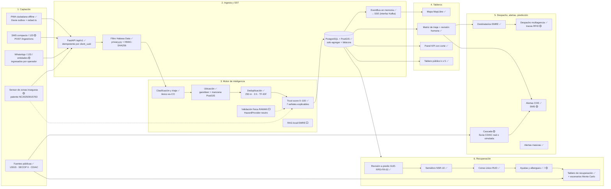
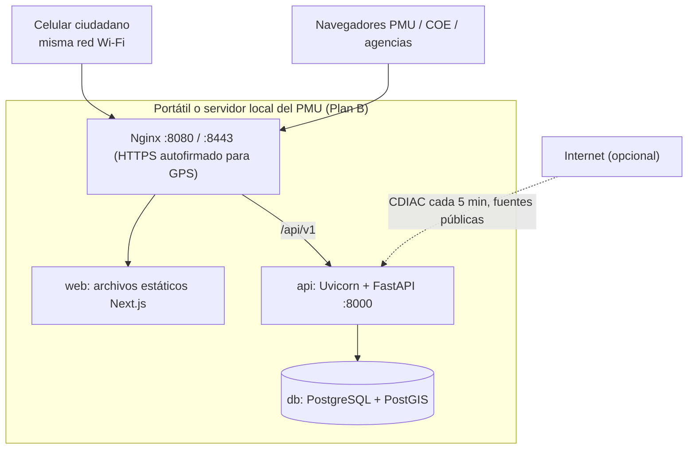
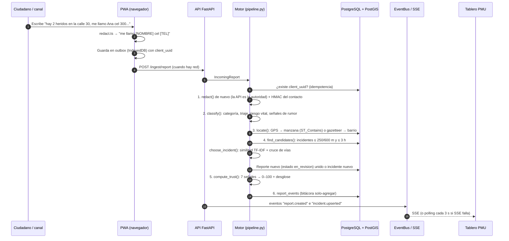
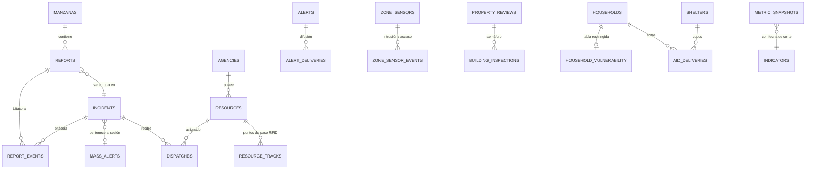
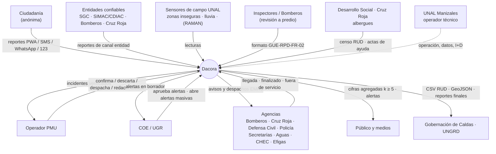
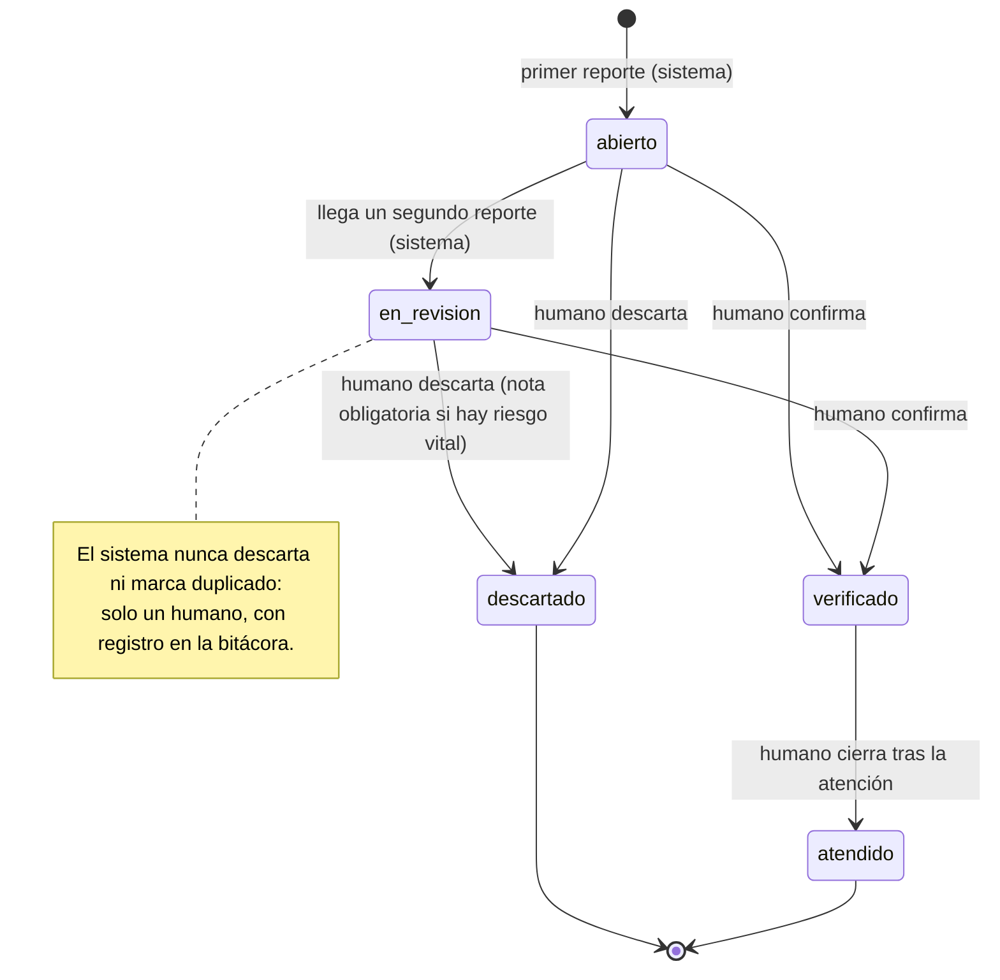

# Dacora — Análisis integral del proyecto

**Datos, alerta y coordinación para la respuesta y la recuperación post-sismo en Manizales y el Eje Cafetero**

Hackathon UNAL Manizales 2026 · Vertical 05 · Datos & Inteligencia Operativa
Documento maestro técnico, operativo, institucional y estratégico · Corte del análisis: 21 nov 2026, 08:20 (hora de Colombia), rama `main`, commit `18604de`

> **Cómo leer este documento.** Cada afirmación técnica remite a archivos reales del repositorio. Se usan tres marcas de estado en todo el texto:
>
> | Marca | Significado |
> |---|---|
> | ✅ **Implementado** | Existe código funcionando, con API, interfaz y, en la mayoría de casos, pruebas automáticas |
> | 🟡 **Simulado / parcial** | El flujo funciona de punta a punta, pero la fuente externa (sensor, gateway, hardware) está reemplazada por una implementación SIMULADA detrás de una interfaz lista para conectar la real |
> | ⬜ **Pendiente** | Está en la arquitectura objetivo o en el plan, pero no hay código |
>
> Todos los datos del prototipo son **sintéticos** (Ley 1581 de 2012). Ningún nombre, cédula o teléfono corresponde a una persona real.

---

## Tabla de contenido

1. [Descripción general, problemática y propósito del proyecto](#1-descripción-general-problemática-y-propósito-del-proyecto)
2. [Arquitectura técnica y funcionamiento del sistema](#2-arquitectura-técnica-y-funcionamiento-del-sistema)
3. [Actores, articulación institucional y gestión de información](#3-actores-articulación-institucional-y-gestión-de-información)
4. [Funcionamiento práctico ante un evento sísmico](#4-funcionamiento-práctico-ante-un-evento-sísmico)
5. [Modelo de negocio: Business Model Canvas](#5-modelo-de-negocio-business-model-canvas)
6. [Apartado especial: contenido para el pitch de ventas](#6-apartado-especial-contenido-para-el-pitch-de-ventas)
7. [Anexo: inventario de estado y evidencias](#7-anexo-inventario-de-estado-y-evidencias)

---

# 1. Descripción general, problemática y propósito del proyecto

## 1.1 Qué es Dacora

**Dacora** es una plataforma abierta de **inteligencia operativa para emergencias** que convierte reportes dispersos (de la ciudadanía, de SMS, de WhatsApp, del 123, de entidades y de sensores de campo) en **incidentes verificados, priorizados y georreferenciados** sobre un tablero común para el Puesto de Mando Unificado (PMU), y que acompaña después la **recuperación** (habitabilidad de predios, censo único de damnificados, ayudas y albergues) sin duplicar visitas, hogares ni beneficios.

En una frase: **Dacora es la "fuente única de verdad" de una emergencia: recibe todo, quita los datos personales, descarta el ruido, une lo repetido, dice cuánto confiar en cada hecho y le muestra a cada entidad lo que le toca hacer.**

El sistema nació en la hackathon con el nombre de trabajo SIDAR/SIRA (estudios de prefactibilidad en Drive) y hoy se llama **Dacora** en interfaz, código y documentación.

## 1.2 El problema central: información que no se convierte en decisiones

El sismo del **10 de agosto de 2026** (M 7,4, 103 km de profundidad, epicentro en San José del Palmar, Chocó, 7:34 a. m.) obligó a Manizales a declarar calamidad pública y a activar PMU, Comité de Emergencias y Sala de Crisis. La evidencia recogida por el equipo muestra que el cuello de botella no fue la falta de datos, sino **la incapacidad de consolidarlos**:

| # | Síntoma observado en el evento | Consecuencia operativa | Cómo lo ataca Dacora |
|---|---|---|---|
| 1 | Viviendas con "afectación total": **1.449** (13 ago) → **2.700** (14 ago) → **1.512** (15 ago) | El COE decide sobre cifras que cambian de un día a otro | Cada cifra muestra **fuente, versión y fecha de corte** (principio V de la constitución) |
| 2 | Gobernación reportó **142** viviendas afectadas el mismo día que la Alcaldía hablaba de **~2.000** solicitudes | Entidades con verdades distintas | Un solo registro (SST) y un **diccionario de indicadores** fijo ([docs/diccionario_indicadores.md](docs/diccionario_indicadores.md)) |
| 3 | "Afectación total", "pérdida total" y "colapso total" usados como sinónimos | Cifras no comparables | Categorías y estados cerrados en el código ([services/api/app/domain.py](services/api/app/domain.py)) |
| 4 | Hasta **3 visitas** al mismo inmueble; se contaban visitas, no predios | Esfuerzo técnico desperdiciado y cifras infladas | **Identificador único de predio** (catastral o manzana + dirección normalizada) |
| 5 | Herramientas ad hoc: Google Forms, SMS sueltos, puntos presenciales | Información fragmentada | Ingesta multicanal en una sola API |
| 6 | Copernicus (EMSR916) **no definió área de interés en Manizales** pese a 361 reportes de daño | Sin cobertura satelital para verificar | Verificación por **corroboración entre fuentes y sensores locales**, no por satélite |
| 7 | Patrón nacional de **30–70 %** de llamadas improcedentes o falsas al 123; cortes de energía y red celular | Saturación y reportes perdidos | Detección de rumores, **trust score** explicable y captura **offline-first** |
| 8 | Lección de 1999: a los 4 días se estimaban **35.000** viviendas afectadas; el censo real fue **79.500**; **731** desaparecidos registrados por confusión | Subestimación grave y duplicidad de registros | Censo único por hogar con HMAC, sin duplicados |

## 1.3 Por qué es necesario

1. **Ventana crítica de rescate.** Las primeras 72 horas definen la supervivencia de personas atrapadas. Un reporte crítico perdido entre cientos de rumores cuesta vidas.
2. **Saturación de canales.** En un sismo urbano, el volumen de mensajes crece en órdenes de magnitud justo cuando la red celular y la energía fallan.
3. **Coordinación multiagencia.** La Estrategia Municipal de Respuesta a Emergencias (EMRE Manizales 2024) define 6 funciones de respuesta y decenas de tareas; sin una herramienta común, cada agencia opera con su propia lista.
4. **Obligación legal.** La Ley 1523 de 2012 (arts. 45–46) exige un sistema de información de gestión del riesgo bajo estándares de datos espaciales, y la Ley 1581 de 2012 exige proteger los datos personales de las víctimas.
5. **Recuperación transparente.** Después del golpe, el riesgo pasa a ser la doble entrega de ayudas, las familias invisibles y las cifras infladas o subestimadas.

## 1.4 A quién beneficia

| Beneficiario | Beneficio directo |
|---|---|
| **Ciudadanía afectada** | Reportar sin señal y sin registrarse; sus datos personales se borran antes de salir del teléfono; ve el mapa público y las alertas oficiales |
| **PMU / COE / UGR Manizales** | Un tablero con incidentes ya agrupados, priorizados y con puntaje de veracidad; KPI con fecha de corte; alertas con control de aprobación |
| **Agencias de respuesta** (Bomberos, Cruz Roja, Defensa Civil, Policía, Secretarías, empresas de servicios) | Bandeja propia con los incidentes que les corresponden según la EMRE, su papel (líder, apoyo, informada) y el despacho multiagencia |
| **Secretaría de Desarrollo Social, inspectores, albergues** | Formato oficial de revisión a predio digitalizado, censo RUD sin duplicados, control de ayudas y ocupación de albergues |
| **Gobernación de Caldas y nivel nacional (UNGRD)** | Cifras consolidadas, trazables y exportables (CSV tipo RUD, GeoJSON) |
| **UNAL Manizales** | Vitrina operativa para sus capacidades (CDIAC/SIMAC, RAMAN, IDE-UNAL, patentes) |

## 1.5 Propuesta de valor

> **De cientos de mensajes contradictorios a una lista corta de hechos verificados, en milisegundos, sin internet y sin exponer a las víctimas.**

- **Velocidad:** el motor procesa un reporte en **< 20 ms (p95)** frente a una meta de 1 s.
- **Limpieza:** en el escenario sintético, **100 %** de duplicados agrupados y **94,7 %** de falsos/rumores detectados, con **0 %** de legítimos marcados como falsos.
- **Seguridad de la vida:** **0** reportes críticos descartados por la IA; el sistema no puede descartar nada solo.
- **Confianza explicable:** cada incidente tiene un puntaje 0–100 con su desglose en 7 señales.
- **Resiliencia:** funciona en un portátil sin internet (Plan B).
- **Privacidad desde el diseño:** redacción de datos personales en el teléfono y en el servidor; solo se guardan huellas HMAC.
- **Continuidad:** el mismo registro alimenta la respuesta y la recuperación.

## 1.6 Objetivos

**Objetivo general.** Reducir el tiempo entre que ocurre un hecho en una emergencia y que la entidad correcta actúa sobre él, con información verificada, trazable y respetuosa de los datos personales.

**Objetivos específicos** (con su estado):

| Objetivo | Indicador | Estado |
|---|---|---|
| Capturar reportes de múltiples canales, incluso sin red | PWA offline + SMS + entidades + operador | ✅ |
| Detectar > 90 % de duplicados y falsos (KPI oficial del reto) | `duplicate_detection_rate`, `fake_detection_rate` | ✅ 100 % / 94,7 % (sintético) |
| No descartar automáticamente ningún reporte con riesgo vital | `critical_auto_discarded = 0` | ✅ |
| Consolidar el mapa en minutos, no en días | `time_to_consolidated_map_min` (p90) | ✅ medido por `evaluate_kpis.py` |
| Enrutar cada incidente a la agencia correcta según la EMRE | Destinatarios líder/apoyo/informada | ✅ |
| Evitar doble despacho y doble ayuda | `double_dispatch_prevented`, `ayudas_duplicadas` | ✅ |
| Contar predios y hogares únicos | `predios_evaluados` vs. `visitas`; `hogares` | ✅ |
| Validar físicamente con acelerógrafos (RAMAN) | Consistencia física en el trust score | ⬜ (interfaz lista, proveedor neutro) |
| Sugerir protocolos con un LLM local (RAG sobre la EMRE) | — | ⬜ |

## 1.7 Alcance

**Dentro del alcance del prototipo:** los seis bloques de la arquitectura objetivo en forma de rebanada vertical (captación → ingesta → motor → tablero → despacho/alertas → recuperación), con integraciones externas detrás de adaptadores SIMULADOS.

**Fuera del alcance actual:** integración con sistemas reales de las entidades (123, SGC, operadores de telefonía), autenticación institucional (Keycloak/SSO), despliegue en alta disponibilidad, hardware LoRa físico, modelos de lenguaje locales.

## 1.8 Diferenciadores frente a los mecanismos tradicionales

| Dimensión | Mecanismo tradicional (2026) | Plataformas genéricas (Ushahidi, formularios) | **Dacora** |
|---|---|---|---|
| Captura sin red | Papel, radio, punto presencial | Requieren conexión | PWA con outbox en IndexedDB + SMS compacto ≤ 160 caracteres |
| Datos personales | Nombres y cédulas en hojas de cálculo | Se almacenan tal cual | Redacción en el borde y en la API; HMAC con sal |
| Duplicados | Conteo manual; visitas repetidas | Verificación manual (la brecha de Haití 2010) | Agrupación automática espacio-tiempo-texto; el duplicado **suma corroboración** |
| Rumores | Se propagan | No se detectan | Señales lingüísticas + canal + fuentes independientes |
| Priorización | Por orden de llegada o criterio individual | Etiquetas manuales | Matriz de triaje Crítico/Alto/Medio/Bajo con reglas explícitas |
| Despacho | Llamadas entre centrales | No existe | Plan multiagencia por funciones EMRE, recurso más cercano, bloqueo de doble despacho |
| Alertas | Sin control de versión | No existe | Borrador → aprobación exclusiva del COE → difusión |
| Cifras | Cambian sin rastro | Sin fecha de corte | Fuente, versión y fecha de corte en cada cifra |
| Recuperación | Sistemas separados del de respuesta | No existe | Mismo registro: predio único, censo RUD, ayudas, albergues |
| Infraestructura | — | Nube | Portátil o servidor local (Plan B), software abierto |

---

# 2. Arquitectura técnica y funcionamiento del sistema

## 2.1 Visión general

Dacora tiene **dos servicios principales** que se comunican exclusivamente por **API REST** (principio X de la constitución, [.specify/memory/constitution.md](.specify/memory/constitution.md)) y un servicio de soporte:

| Servicio | Tecnología | Responsabilidad | Ubicación |
|---|---|---|---|
| `api` | Python 3.12 · FastAPI · Pydantic v2 · SQLAlchemy 2 (async, asyncpg) · GeoAlchemy2 · Alembic · scikit-learn · Shapely | Toda la lógica de negocio, el motor de verificación, los adaptadores y el acceso a la base | [services/api](services/api) |
| `web` | Next.js 16 (exportación estática) · React 19 · TypeScript estricto · Tailwind 4 · MapLibre GL 6 · Dexie 4 · openapi-fetch · servido por **Nginx** | Frontend puro: PWA ciudadana, tablero PMU, agencias, recuperación, administración | [apps/web](apps/web) |
| `db` | PostgreSQL 16 + PostGIS 3.5 | Fuente única de verdad (SST), consultas espaciales | imagen `imresamu/postgis:16-3.5` |

Todo se levanta con `docker compose up -d --build` ([docker-compose.yml](docker-compose.yml)). Después de la primera construcción **no se necesita internet**: geografía, mapa base y modelos son locales.

## 2.2 Diagrama de arquitectura real (estado actual)

La versión gráfica oficial del estado actual está en [docs/arquitectura_actual.png](docs/arquitectura_actual.png) (fuente editable [docs/arquitectura_actual.svg](docs/arquitectura_actual.svg)); la arquitectura objetivo, en [docs/arquitectura.jpeg](docs/arquitectura.jpeg).

## 2.3 Despliegue y matriz de resiliencia

| Plan | Condición | Cómo opera Dacora hoy | Estado |
|---|---|---|---|
| **A — Online** | Internet disponible | Igual que B + lluvia real del CDIAC/SIMAC y descarga de fuentes públicas (`scripts/fetch_sources.py`) | ✅ |
| **B — Offline-first** | Sin internet, con red local | Todo el sistema corre en un portátil; la PWA guarda reportes en el teléfono y los envía al volver la red; el tablero muestra la última copia guardada con su fecha ([apps/web/lib/offline.ts](apps/web/lib/offline.ts)) | ✅ |
| **C — Colapso total** | Sin red celular | Mensajes compactos tipo SMS desde nodos LoRa/Meshtastic usando el mismo formato `DACORA …` (el canal `lora` ya existe en el modelo) | 🟡 canal y formato listos; ⬜ hardware y pasarela |

## 2.4 Flujo de la información: de un mensaje a un incidente

El corazón del sistema es `process_report` en [services/api/app/core/pipeline.py](services/api/app/core/pipeline.py). Cada reporte recorre estos pasos dentro de una única transacción con **bloqueo asesor** de PostgreSQL (agrupación serializada para evitar condiciones de carrera):

### Paso 1 — Filtro Habeas Data ✅

- **Dónde:** [services/api/app/core/privacy.py](services/api/app/core/privacy.py) (autoridad) y su espejo [apps/web/lib/redact.ts](apps/web/lib/redact.ts) (en el teléfono). Ambos se prueban contra los mismos casos en [data/fixtures/pii_cases.json](data/fixtures/pii_cases.json).
- **Qué detecta, en orden:** correos → celulares colombianos (`3XX XXX XXXX`, con o sin +57) → cédulas (6–10 dígitos, con o sin puntos de miles) → placas (`ABC123`, `ABC12D`) → nombres tras disparadores ("me llamo", "mi nombre es", "soy", "mi mamá se llama"…).
- **Qué guarda:** marcadores `[NOMBRE]`, `[TEL]`, `[CC]`, `[CORREO]`, `[PLACA]` y, del contacto del remitente, solo `HMAC-SHA256(sal, dato_normalizado)` (`reporter_hash`). Esto permite saber que dos reportes vienen de la misma persona **sin saber quién es**.
- **Garantía verificada:** la prueba [services/api/tests/integration/test_pii_scenario.py](services/api/tests/integration/test_pii_scenario.py) recorre el escenario completo y falla si aparece un teléfono, cédula o correo en la base.

### Paso 2 — Clasificación y triaje ✅

- **Dónde:** [services/api/app/core/nlp.py](services/api/app/core/nlp.py). Clasificador **determinista y explicable** por léxico en español colombiano (se puede rastrear qué expresión disparó cada decisión).
- **15 categorías:** `personas_atrapadas`, `heridos`, `colapso_estructura`, `dano_estructural`, `incendio`, `fuga_gas`, `deslizamiento`, `via_bloqueada`, `servicios_caidos`, `necesidad_albergue`, `necesidad_ayuda`, `persona_desaparecida`, `sismo_sentido`, `rumor_informacion`, `sin_clasificar`.
- **Reglas de escalamiento** (función `_triage`): un colapso con personas sube a **Crítico**; un deslizamiento sobre viviendas sube a Crítico; un daño estructural "leve" baja a Bajo y uno "severo/columna/inclinado" o cerca de hospital sube a Alto; una vía bloqueada hacia hospital o albergue sube a Alto.
- **Señales de desinformación:** "reenvía", "cadena", "dicen que", "me contaron", "urgente compartir/compartan/difundan", "va a temblar", "predicción/pronóstico/NASA", "miles de muertos", "réplica de 7+".
- **Regla de seguridad:** si un mensaje tiene lenguaje de cadena **pero menciona riesgo vital**, no se convierte en rumor: conserva su categoría crítica y baja su puntaje, para que lo revise un humano.

### Paso 3 — Georreferenciación ✅

- **Dónde:** [services/api/app/core/geo.py](services/api/app/core/geo.py) y `_manzana_for` en el pipeline.
- **Orden de preferencia:** GPS del teléfono → coordenadas del SMS → referencia del gazetteer (Catedral, Hospital Santa Sofía, Cable Aéreo…) → barrio → nada.
- **Precisión registrada:** `gps`, `address`, `barrio`, `none`. Influye en el radio de agrupación y en el trust score.
- **Geografía local** ([data/geo](data/geo)): **12 comunas reales** (OpenStreetMap, ODbL), **40 barrios** (puntos reales de OSM; polígonos aproximados por Voronoi), **724 manzanas** (grilla de ~200 m con atributos SIMULADOS) y un **gazetteer de 62 lugares** con alias.

### Paso 4 — Deduplicación ✅

- **Dónde:** [services/api/app/core/dedup.py](services/api/app/core/dedup.py) y [services/api/app/core/similarity.py](services/api/app/core/similarity.py). Parámetros en `DedupSettings` ([services/api/app/config.py](services/api/app/config.py)).
- **Reglas:** categoría igual o compatible (p. ej. atrapados ↔ colapso ↔ daño estructural ↔ heridos; gas ↔ incendio; deslizamiento ↔ vía bloqueada) **y** distancia ≤ 250 m (≤ 600 m si alguno se ubicó solo por barrio) **y** ventana ≤ 3 h **y** similitud de texto sobre el umbral. Si ambos textos mencionan el mismo cruce de vías ("calle 43 con carrera 23"), se toleran hasta 1,5 km.
- **Similitud:** TF-IDF de n-gramas de caracteres 3–5 (tolera errores de SMS, sin descargas). Umbrales calibrados con `evaluate_kpis.py`: 0,15 (0,10 con ubicación exacta). Proveedor alternativo `minilm` (sentence-transformers) si está instalado; si no, cae a TF-IDF sin romper nada.
- **Duplicado ≠ basura:** el reporte se une al incidente, **suma fuentes independientes** y puede mejorar su ubicación (el centroide usa los reportes más precisos).
- **Fuentes independientes:** se cuentan `reporter_hash` distintos; el mismo remitente repitiendo el mensaje no cuenta dos veces, y las cadenas reenviadas cuentan como máximo una.

### Paso 5 — Puntaje de veracidad (trust score) ✅

- **Dónde:** [services/api/app/core/trust.py](services/api/app/core/trust.py) (`compute_trust`, versión `trust-v1`).

| Señal | Puntos máx. | Cómo se calcula |
|---|---|---|
| Confiabilidad del canal | 30 | Mejor canal del incidente: entidad 0,9 · LoRa 0,6 · PWA con GPS y foto 0,6 · PWA/SMS 0,5 · 123 0,4 · WhatsApp reenviado 0,3 |
| Fuentes independientes | 25 | Proporcional, satura en 4 fuentes |
| Consistencia física | 20 | Desde `HazardProvider`. **Hoy neutro (0,5 → 10 pts)**: "sin dato de sensor" ⬜ |
| Precisión geográfica | 10 | GPS 100 % · dirección 70 % · barrio 50 % · nada 0 % |
| Desinformación | −15 a 0 | −7,5 por señal, promediado entre los reportes |
| Evidencia (foto) | 5 | Si algún reporte trae foto |
| Sensor de campo | 10 | Intrusión detectada por ambos detectores de un sensor de zona insegura a ≤ 150 m en las últimas 3 h ✅ (simulado) |

**Etiquetas:** Verificado ≥ 75 · Probable 50–74 · Sin verificar 25–49 · Posible falso < 25. El desglose completo se guarda en `trust_breakdown` (JSONB) y se muestra en el tablero tal cual.

### Paso 6 — Bitácora y estado ✅

- Los reportes son **solo-agregar**. Todo cambio queda en `report_events` con `actor_role`, acción y hora.
- **El actor `sistema` solo puede llevar reportes a `en_revision`**; nunca a `descartado` ni a `duplicado` (regla en el pipeline y en [services/api/app/core/review.py](services/api/app/core/review.py)). Descartar un incidente con riesgo vital exige una nota humana.

## 2.5 Módulos funcionales y estado real

### 2.5.1 Captación

| Módulo | Detalle | Archivos | Estado |
|---|---|---|---|
| PWA ciudadana | Formulario corto (categoría, descripción, GPS o barrio, personas, foto opcional), **aviso de privacidad y consentimiento obligatorio**, redacción en el teléfono, outbox en IndexedDB con `client_uuid`, reenvío automático al volver la red, service worker para recargar sin red | [apps/web/app/reportar/ReporteCiudadano.tsx](apps/web/app/reportar/ReporteCiudadano.tsx), [apps/web/lib/db.ts](apps/web/lib/db.ts), [apps/web/public/sw.js](apps/web/public/sw.js) | ✅ |
| GPS desde celular | HTTPS autofirmado en `:8443` para que el navegador entregue la ubicación | [apps/web/nginx.conf](apps/web/nginx.conf) | ✅ |
| SMS compacto | `DACORA <CÓDIGO> <BARRIO o lat,lon> <N> <texto>` ≤ 160 caracteres; 12 códigos (ATR, HER, COL, DAN, INC, GAS, DES, VIA, SER, ALB, AYU, DSP); un SMS sin formato nunca falla: entra como texto libre a revisión | [services/api/app/core/sms.py](services/api/app/core/sms.py), `POST /ingest/sms` | ✅ endpoint · 🟡 sin gateway real (`scripts/simulate_sms.py`) |
| WhatsApp, 123, entidades | Canales del modelo; los registra el operador PMU/COE vía `POST /ingest/report` con el canal correspondiente | [services/api/app/routers/ingest.py](services/api/app/routers/ingest.py) | 🟡 sin conector automático |
| Lote / sincronización | `POST /ingest/batch` para vaciar el outbox | idem | ✅ |
| Incidentes manuales | El PMU crea incidentes avisados por radio; nacen verificados y la descripción se redacta | [services/api/app/core/manual_incident.py](services/api/app/core/manual_incident.py) | ✅ |
| Sensor de zonas inseguras | 6 sensores SIMULADOS en edificios acordonados, cono de 12 m (±30°), ultrasonido + infrarrojo + RFID (21 credenciales de rescatistas). Intrusión sin tarjeta → alarma; con tarjeta → acceso autorizado. Punto de integración real: `POST /sensors/zones/{id}/readings` | [services/api/app/core/zone_sensor.py](services/api/app/core/zone_sensor.py), [services/api/app/adapters/zone_sensor.py](services/api/app/adapters/zone_sensor.py) | 🟡 |
| LoRa / Meshtastic | Canal `lora` en el modelo y en el trust score | [services/api/app/domain.py](services/api/app/domain.py) | ⬜ pasarela y hardware |

### 2.5.2 Tableros

| Pantalla | Ruta | Quién | Qué muestra | Estado |
|---|---|---|---|---|
| Inicio público | `/` | Cualquiera, sin sesión | Mapa agregado por manzana con **k ≥ 5**, triaje sin texto y con ubicación aproximada, cascada, zonas inseguras, alertas vigentes, KPI | ✅ |
| Tablero PMU | `/pmu/` | `coe`, `pmu` | Mapa MapLibre (incidentes coloreados por triaje y dimensionados por reportes, calor por manzana, recursos, áreas de alerta, cascada, sensores), pestañas Triaje / Despacho / Alertas / Cascada / Zonas, control de capas, selector de sesión, indicador **En vivo** (SSE) o **Modo de respaldo** (polling 3 s) | ✅ |
| Detalle de incidente | panel lateral | `coe`, `pmu` | Reportes redactados, desglose del trust score, bitácora, "A quién le llega", botones Confirmar / Descartar / Marcar duplicado / Cerrar como atendido | ✅ |
| Gestión de incidentes | `/pmu/gestion/` | `coe`, `pmu` | Bandejas *Sin asignar*, *Operación ordinaria* y cada alerta masiva; asignar, desacoplar, crear a mano, cerrar alertas | ✅ |
| Reporte de alerta masiva | `/pmu/alerta-masiva/?id=` | `coe`, `pmu` | Trazabilidad por incidente y tiempos registro→verificación→despacho→llegada→cierre (promedio, mediana, máximo por triaje); PDF, CSV, JSON | ✅ |
| Panel de KPI | `/pmu/kpi/` | Cualquiera | 12 indicadores con fuente y fecha de corte | ✅ |
| Agencia | `/agencia/` | `bomberos`, `cruzroja`, `defensacivil`, `infraestructura` | Avisos de su agencia con papel y tarea EMRE; despachos; "Llegamos al sitio", "Atención finalizada", "Fuera de servicio" | ✅ |
| Recuperación | `/recuperacion/` | `coe`, `pmu` | Habitabilidad, censo único, ayudas, albergues, tablero de recuperación | ✅ |
| Administración | `/admin/` | `admin` | Simulación con datos (escenario) o sin datos; fuente de lluvia simulada/CDIAC en caliente | ✅ |

### 2.5.3 Despacho, alertas y predicción

| Módulo | Detalle | Archivos | Estado |
|---|---|---|---|
| Destinatarios por EMRE | Para cada incidente calcula agencias **líder**, **apoyo** e **informada**, citando la tarea EMRE (p. ej. atrapados → Bomberos líder "1.2 Búsqueda y rescate"; Cruz Roja, Defensa Civil y Policía de apoyo). Reglas especiales: servicios caídos detecta si es agua/energía/gas en el texto; heridos graves suman Bomberos; daño severo suma evacuación preventiva y acordonamiento. Lo que es "posible falso" sin riesgo vital queda **retenido** hasta la verificación humana | [services/api/app/core/recipients.py](services/api/app/core/recipients.py) | ✅ |
| Despacho multiagencia | Propone el recurso **más cercano y del tipo adecuado** por agencia líder y de apoyo; un humano confirma con un clic | [services/api/app/core/dispatch.py](services/api/app/core/dispatch.py) | ✅ |
| Antidoble despacho | Índice único parcial (un despacho activo por recurso) y bloqueo de fila del incidente; un segundo despacho exige justificar refuerzo; se cuenta como `double_dispatch_prevented` | idem | ✅ |
| Trazas tipo RFID | Recursos avanzan base → incidente con puntos de control en 1/3, 2/3 y llegada, 20× acelerado (patente UNAL 15111163) | [services/api/app/adapters/tracks.py](services/api/app/adapters/tracks.py) | 🟡 |
| Tiempo estimado de llegada | Línea recta × tortuosidad 1,4 a 25 km/h; interfaz `RoutingProvider` para la API de rutas de ERIS-UNAL | [services/api/app/adapters/routing.py](services/api/app/adapters/routing.py) | 🟡 |
| Críticos sin atender | Marca críticos sin despacho después de 15 min (`UNATTENDED_ALERT_MIN`) | config | ✅ |
| Alertas oficiales | Área por barrios, círculo o polígono; mensaje redactado y validado para SMS (≤ 160); bloqueo si el mensaje tiene señales de rumor sin confirmación; **borrador → aprobación solo del COE** (EMRE tarea 5.5) → difusión en tablero y mapa público; control de versión optimista | [services/api/app/core/alerts.py](services/api/app/core/alerts.py) | ✅ |
| Difusión SMS a cuadrillas | Registra el **número** de destinatarios (recursos en el área), nunca números ni identidades | [services/api/app/adapters/alert_gateway.py](services/api/app/adapters/alert_gateway.py) | 🟡 |
| Alertas masivas | Sesiones de ciudad (p. ej. "Sismo"); varias a la vez; incidentes nuevos quedan *sin asignar*; cierre bloqueado con incidentes abiertos; reporte final con tiempos | [services/api/app/core/mass_alert.py](services/api/app/core/mass_alert.py) | ✅ |
| Efectos en cascada | Riesgo por manzana = pendiente (35) + lluvia 3 h (30) + componente sísmico (15) + reportes cercanos de daño/deslizamiento (20); niveles Bajo/Medio/Alto/Muy alto; desde una manzana "Muy alto" se crea una alerta preventiva | [services/api/app/core/cascade.py](services/api/app/core/cascade.py) | 🟡 pendiente SIMULADA, componente sísmico neutro; **lluvia real del CDIAC/SIMAC** disponible ✅ |

### 2.5.4 Recuperación post-sismo (diferencial)

| Módulo | Detalle | Estado |
|---|---|---|
| Revisión a predio | Versión digital del formato oficial **GUE-RPD-FR-02 v4** de la Alcaldía, sección por sección; el N.º impreso es llave única; nombres, teléfonos, firmas y cédulas **se quedan en el papel**; derivaciones a UGR, Corpocaldas, Aguas de Manizales, CHEC, etc., pendientes hasta que la entidad marca su visita ([services/api/app/routers/recovery_reviews.py](services/api/app/routers/recovery_reviews.py)) | ✅ |
| Semáforo NSR-10 | Sugerido desde la afectación y la evacuación (ninguna → verde, parcial → amarillo, total o evacuar → rojo); rechaza combinaciones incoherentes ([services/api/app/core/recovery.py](services/api/app/core/recovery.py)) | ✅ |
| Predio único | Código catastral o manzana + dirección normalizada: "Cra. 23 # 45-10" y "carrera 23 45 10" son el mismo predio; las visitas repetidas se suman | ✅ |
| Censo único (RUD) | Hogar identificado por **HMAC del documento del jefe de hogar** (nunca el número); "1053123456" y "1.053.123.456" son el mismo hogar; vulnerabilidad en tabla separada con acceso restringido; exportación CSV con columnas tipo RUD sin datos personales | ✅ |
| Ayudas | Actas de entrega (subsidio de arriendo, kit, mercado, cupo en albergue); la misma ayuda al mismo hogar dentro de su plazo (30 días; 7 para mercado) **se bloquea** salvo justificación | ✅ |
| Albergues | Operador, estado, servicios, ocupación automática por entradas y salidas | ✅ lógica · 🟡 albergues simulados |
| Tablero de recuperación | Los "10 indispensables", 5 etapas (El golpe, La plata disponible, La plata en movimiento, La reactivación, La estabilización), índice de recuperación, familias en predio rojo sin solución de vivienda. **Ninguna cifra inventada**: o viene del registro de Dacora o de copias fechadas con huella SHA-256 de fuentes públicas (USGS, SECOP II, CDIAC); lo demás se muestra como "sin fuente" | ✅ |
| Escenarios de acceso a datos | Monte Carlo (2.000 corridas por día) sobre una verdad simulada: **mejor caso** (convenios) vs. **peor caso** (sin convenios) — ver [docs/escenarios_recuperacion.md](docs/escenarios_recuperacion.md) | ✅ (SIMULADO) |
| Portal público "Reconstruir Mejor" | Índice por barrio agregado | ⬜ |

### 2.5.5 Métricas, demo y calidad

| Elemento | Detalle | Estado |
|---|---|---|
| KPI en vivo | `GET /metrics/kpi`: reportes vs. incidentes, detección de duplicados y falsos, críticos descartados, tiempo a mapa (p90), procesamiento p95, críticos sin despacho, mediana a despacho, despachos dobles evitados | ✅ |
| Verdad del escenario aislada | `evaluate_kpis.py` compara contra [data/seed/ground_truth.json](data/seed/ground_truth.json) y publica instantáneas; **la API nunca lee la verdad** (principio IV) | ✅ |
| Escenario sintético | **254 reportes** en 12 h: SMS 75, PWA 67, WhatsApp 49, 123 44, entidades 19; 10 agencias y 24 recursos | ✅ |
| Reproducción | `replay_scenario.py --speed 120/720` (cliente de la misma API REST) | ✅ |
| Pruebas | **151 pruebas** de API (unitarias, integración y contrato OpenAPI) y **11** de web (redacción en el borde, outbox, formato) | ✅ |
| Reporte de situación exportable y nivel EMRE sugerido | Cadencia 6/12/24 h y niveles 0–3 | ⬜ (el reporte final de alerta masiva cubre parte de la trazabilidad) |

## 2.6 Modelo de datos (SST)

Nueve migraciones Alembic ([services/api/alembic/versions](services/api/alembic/versions)) construyen el esquema:

Rasgos de diseño: `client_uuid` único para idempotencia; geometrías `POINT/POLYGON 4326`; `trust_breakdown` JSONB; tabla de vulnerabilidad separada; `reporter_hash` y `household_hash` como HMAC; `source`, `version` y `cutoff_at` en las cifras.

## 2.7 API REST

**76 operaciones** bajo `/api/v1`, contrato en `/openapi.json` y tipos TypeScript generados ([apps/web/lib/api/schema.d.ts](apps/web/lib/api/schema.d.ts)); una prueba de contrato impide que cambien sin regenerar los tipos.

| Grupo | Rutas principales |
|---|---|
| Ingesta | `POST /ingest/report`, `/ingest/sms`, `/ingest/batch` |
| Reportes e incidentes | `GET /reports`, `PATCH /reports/{id}`, `GET/POST /incidents`, `PATCH /incidents/{id}`, `POST /incidents/assign` |
| Mapa | `GET /map/manzanas`, `/map/cascade`, `/geo/barrios` |
| Despacho | `GET /agencies`, `/agencies/{id}/inbox`, `GET/POST /dispatches`, `PATCH /dispatches/{id}`, `POST /incidents/{id}/dispatch-plan`, `GET /resources`, `GET/POST /resources/{id}/tracks` |
| Alertas | `GET/POST /alerts`, `/alerts/active`, `/alerts/{id}/approve`, `/reject`, `/cancel`, `/events` |
| Alertas masivas | `GET/POST /mass-alerts`, `/mass-alerts/{id}/close`, `/report` |
| Sensores | `/sensors/rain` (+ fuente CDIAC), `/sensors/zones` (+ lecturas, eventos, atender) |
| Recuperación | `/recovery/reviews`, `/inspections`, `/properties`, `/households` (+ `export.csv`, `lookup`, `rud`), `/aid`, `/shelters`, `/referrals`, `/summary`, `/dashboard`, `/scenarios` |
| Métricas | `GET /metrics/kpi`, `POST /metrics/snapshots` |
| Tiempo real | `GET /stream` (SSE; única excepción al REST puro) |
| Autenticación y demo | `POST /auth/login`, `GET /auth/demo-users`, `/demo/reset`, `/demo/simulation` |

## 2.8 Seguridad, privacidad y control de acceso

| Control | Implementación | Estado |
|---|---|---|
| Roles | `publico` (anónimo), `operador_pmu`, `coe`, `inspector`, `agencia`, `admin`, `sistema` ([services/api/app/auth.py](services/api/app/auth.py)) | ✅ |
| Autenticación | Token fijo por rol (demo); usuarios de prueba ficticios con contraseña de demo ([services/api/app/core/users.py](services/api/app/core/users.py)) | 🟡 apto para demo, no para producción |
| Ciudadanía sin cuenta | Reporta y consulta como anónima; no se le pide registro | ✅ |
| Datos personales | Redacción doble, HMAC con sal (`PII_SALT`), vulnerabilidad en tabla aparte, exportes sin PII | ✅ |
| Publicación | Cifras públicas agregadas con **k-anonimato k ≥ 5** (supresión "< 5") | ✅ |
| Auditoría | Bitácora solo-agregar con rol y hora; reportes nunca se sobrescriben | ✅ |
| Separación de deberes | Solo el COE aprueba alertas; solo humanos descartan | ✅ |
| Pendiente para producción | SSO institucional (Keycloak), TLS con certificado válido, gestión de secretos, cifrado en reposo, copias de seguridad, registro de tratamiento ante la SIC | ⬜ |

## 2.9 Integraciones detrás de adaptadores (principio VI)

| Interfaz | Implementación actual | Implementación real prevista |
|---|---|---|
| `HazardProvider` | `NeutralHazardProvider` (consistencia 0,5) | Acelerógrafos RAMAN, ShakeMap/FDSN del SGC, prior de daño SISMAN-LISA |
| `RoutingProvider` | Línea recta × tortuosidad (SIMULADO) | API de rutas con probabilidad de bloqueo de ERIS-UNAL |
| `TrackFeed` | `SimulatedRfidFeed` | Lectores RFID vehiculares (patente 15111163) |
| `AlertGateway` | `SimulatedGateway` (cuenta destinatarios) | Gateway SMS / push / cell broadcast |
| `EventBus` | Colas asyncio en memoria → SSE | Apache Kafka |
| `TerrainProvider` | `SyntheticTerrain` | Modelo digital de elevación IDE-UNAL / IGAC |
| `RainFeed` | Simulado **o CDIAC/SIMAC real** (IDW por estación, cada 5 min, respaldo automático si el dato tiene > 60 min) | ✅ ya conectado |
| `SimilarityProvider` | TF-IDF | MiniLM multilingüe (opcional, ya soportado) |
| Fuentes públicas | Copias fechadas con SHA-256 de USGS (FDSN), SECOP II, CDIAC | SGC FDSN, UNGRD, DANE, catastro |

## 2.10 Cumplimiento de los criterios de "terminado" del P0

| Criterio (CLAUDE.md §14) | Estado |
|---|---|
| `docker compose up` desde cero y carga del escenario | ✅ |
| PWA en modo avión sincroniza sin duplicar | ✅ |
| Ningún teléfono, cédula o correo en la base (prueba automática) | ✅ |
| `evaluate_kpis.py` > 90 % y 0 críticos descartados | ✅ |
| Tablero en vivo (SSE) y cifras con fuente y fecha de corte | ✅ |
| Guion de demo para cualquier integrante ([docs/guion_demo.md](docs/guion_demo.md)) | ✅ |
| Video o GIF de respaldo | 🟡 GIF fuera del repositorio; video completo pendiente |

---

# 3. Actores, articulación institucional y gestión de información

## 3.1 Mapa de actores

## 3.2 Responsabilidades, funcionalidades y decisiones por actor

| Actor | Rol en el sistema | Qué aporta | Qué ve y puede hacer | Qué decide | Estado |
|---|---|---|---|---|---|
| **Ciudadanía** | `publico` (sin sesión) | Reportes con categoría, descripción, ubicación, personas, foto | Reportar offline; ver mapa agregado, triaje sin texto, alertas vigentes, cascada, zonas, KPI | Nada operativo; su reporte siempre llega a revisión | ✅ |
| **Operador PMU** | `operador_pmu` (usuario `pmu`) | Registro de reportes de WhatsApp/123/radio; incidentes manuales | Tablero completo, detalle con desglose, bitácora, despacho, borradores de alertas, alertas masivas, gestión de incidentes, recuperación | Confirmar, descartar (con nota si hay riesgo vital), marcar duplicado, cerrar como atendido, confirmar despachos, redactar alertas | ✅ |
| **COE / UGR** | `coe` (usuario `coe`) | Decisión política y técnica | Todo lo del PMU | **Única autoridad para aprobar alertas oficiales** (EMRE 5.5); abrir y cerrar alertas masivas; declarar niveles (fuera del sistema hoy) | ✅ |
| **Agencias de respuesta** | `agencia` (usuarios `bomberos`, `cruzroja`, `defensacivil`, `infraestructura`) | Estado del despacho en terreno | Bandeja de avisos con su papel (líder/apoyo/informada) y tarea EMRE; sus despachos | Marcar llegada, atención finalizada, recurso fuera de servicio | ✅ |
| **Inspectores / Bomberos (recuperación)** | `coe`/`pmu` en la demo (rol `inspector` existe) | Formatos de revisión a predio | Habitabilidad, visitas pendientes por entidad | Semáforo del predio (con sugerencia NSR-10) y recomendación de evacuar | ✅ |
| **Desarrollo Social / Cruz Roja (asistencia)** | `coe`/`pmu` en la demo | Planillas RUD, actas de entrega | Censo, ayudas, albergues | Inscripción RUD, entregas, justificación de ayuda repetida | ✅ |
| **Empresas de servicios** (Aguas de Manizales, CHEC, Efigas) | Destinatarias en el ruteo | Restablecimiento | Avisos de "servicios caídos" con servicio detectado | Restablecer | 🟡 aparecen como agencias; sin usuario propio en la demo |
| **UNAL Manizales** | Operador técnico (propuesto) | Capas (CDIAC lluvia ✅, RAMAN ⬜, IDE-UNAL), patentes, supercómputo | Administración | Calibración de modelos, operación del servidor | 🟡 |
| **Gobernación / UNGRD** | Consumidores de datos | — | Exportes CSV RUD y GeoJSON | Apoyo departamental y nacional | 🟡 exportes listos, sin integración |
| **Administrador** | `admin` | — | Simulaciones, fuente de lluvia | Reiniciar escenario | ✅ |

## 3.3 Cómo se articulan las instituciones a través de Dacora

La EMRE Manizales 2024 organiza la respuesta en **6 funciones**. Dacora traduce cada categoría de incidente a esas funciones y a sus tareas específicas, de modo que la articulación deja de depender de llamadas entre centrales:

| Función EMRE | Categorías que la activan | Líder sugerido | Apoyo / informadas (ejemplos reales del código) |
|---|---|---|---|
| 1. Salvamento y seguridad | atrapados, colapso, incendio, fuga de gas | Bomberos | Cruz Roja, Defensa Civil, Policía (acordonar), Efigas y CHEC (cortar servicios) |
| 2. Salud y saneamiento | heridos | Cruz Roja | Secretaría de Salud; Bomberos si son graves o ≥ 5 personas |
| 3. Asistencia social | albergue, ayuda, desaparecidos | Desarrollo Social | Cruz Roja |
| 4. Infraestructura, servicios y ambiente | daño estructural, vía bloqueada, servicios caídos, deslizamiento | Secretaría de Infraestructura / empresa del servicio | Defensa Civil (evacuación), Policía, Bomberos (deslizamiento sobre viviendas) |
| 5. Manejo y coordinación | todo lo crítico, rumores, alertas | COE / UGR | Informado siempre de lo crítico (tarea 5.2, información pública) |
| 6. Logística | recursos | UGR | Trazabilidad de recursos y antidoble despacho |

**Regla de oro de la articulación:** el sistema **propone** (a quién le llega, qué recurso, qué alerta) y **un humano confirma** (CLAUDE.md §0.6, constitución principio III). Lo que tiene riesgo vital **siempre** se avisa, aunque su confianza sea baja; lo demás con "posible falso" queda retenido hasta la verificación.

## 3.4 Qué información necesita cada institución y cómo se comparte

| Información | Producida por | Necesitada por | Canal en Dacora | Protección |
|---|---|---|---|---|
| Incidente verificado con ubicación y triaje | Motor + PMU | Agencias, COE | Bandeja de agencia, tablero, SSE | Texto redactado |
| Desglose de veracidad | Motor | PMU, COE | Panel de detalle | — |
| Estado de despacho y posición de recursos | Agencias, RFID | PMU, COE | Tablero, trazas | — |
| Alerta oficial | COE | Ciudadanía, cuadrillas | Tablero público, SMS (simulado) | Mensaje redactado; sin números guardados |
| Riesgo de cascada | Motor + CDIAC | COE, Infraestructura, Corpocaldas | Capa de cascada | — |
| Habitabilidad por predio | Inspectores | Desarrollo Social, UGR, Planeación | Recuperación | Sin nombres ni firmas |
| Censo de hogares | Desarrollo Social | UNGRD (RUD), Gobernación | CSV tipo RUD | HMAC; vulnerabilidad restringida |
| Ayudas entregadas | Cruz Roja, Desarrollo Social | Hacienda, entes de control | Actas, tablero | HMAC del hogar |
| Cifras públicas | Todo lo anterior | Medios, ciudadanía | Inicio público, KPI | k ≥ 5 |

## 3.5 Contribución a las cuatro decisiones clave

| Decisión | Sin Dacora | Con Dacora |
|---|---|---|
| **Verificar** un reporte | Llamar de vuelta, enviar a alguien a mirar | Puntaje 0–100 con desglose; corroboración entre fuentes y sensores; el humano confirma en un clic |
| **Priorizar** | Orden de llegada | Matriz de triaje explícita y críticos sin despacho marcados a los 15 min |
| **Coordinar recursos** | Llamadas entre centrales; riesgo de enviar dos veces | Plan multiagencia por EMRE, recurso más cercano, bloqueo de doble despacho, trazas |
| **Decidir y comunicar** | Cifras contradictorias; alertas sin control | Cifras con fuente y corte; alertas solo con aprobación COE; reporte final con tiempos |

---

# 4. Funcionamiento práctico ante un evento sísmico

> **Simulación narrativa.** Lo que sigue describe cómo operaría Dacora con su funcionalidad **actual** durante un sismo hipotético en Manizales. Los nombres de personas, direcciones exactas y cifras de la narración son **ficticios**. Donde un paso depende de algo pendiente, se indica.

## 4.1 Antes del evento (preparación)

| Momento | Qué pasa | Actores | Módulo |
|---|---|---|---|
| Meses antes | La UGR instala Dacora en el servidor del PMU y en un portátil de respaldo (`docker compose up`). Se cargan comunas, barrios, manzanas, gazetteer, agencias y recursos. | UGR, UNAL | Infraestructura |
| | Se capacita al personal con los casos de ejemplo de recuperación ([docs/guia_recuperacion.md](docs/guia_recuperacion.md)) y con la simulación del administrador. | UGR, Bomberos, Desarrollo Social | `/admin/`, `/recuperacion/` |
| | Se difunde a la ciudadanía el enlace de la PWA y el formato SMS `DACORA ATR MILAN 3 …` | Comunicaciones UGR | PWA, SMS |
| | La fuente de lluvia se deja en **CDIAC** (si hay internet) para que la capa de cascada use precipitación real. | Admin | `/admin/` |
| | Sensores de zonas inseguras listos para instalarse en edificios acordonados. | UNAL / Bomberos | Zonas |

## 4.2 Durante y después del evento: cronología

**Escenario:** martes, 7:34 a. m. Sismo fuerte sentido en todo Manizales. Cortes de energía en Comuna Cumanday y en sectores de La Estación; la red celular se satura.

### T+0 a T+15 min — El golpe y la avalancha de mensajes

1. **07:36** — El COE entra a `/pmu/` y pulsa **Activar alerta masiva → Sismo → toda la ciudad**. Desde ese momento, cada incidente nuevo queda en la bandeja **Sin asignar** hasta que una persona lo ubique en la sesión correcta; los incidentes ordinarios previos siguen en *Operación ordinaria*.
2. **07:38** — Llegan los primeros mensajes. La mayoría son `sismo_sentido` ("que susto, se movió todo"): el motor los clasifica como **Bajo**, severidad 1. No ocupan la atención del operador.
3. **07:41** — Una vecina en **Milán**, sin señal, abre la PWA que tenía guardada, escribe *"edificio caido en la carrera 23, hay gente adentro, me llamo Laura cel 3101234567"*, elige barrio Milán y envía. La PWA la redacta **en el teléfono** (`me llamo [NOMBRE] cel [TEL]`) y la deja en el outbox: "Guardado en su teléfono".
4. **07:44** — Un SMS llega por el canal compacto: `DACORA ATR MILAN 3 edificio caido cra 23`. El parser lo traduce a *personas atrapadas, Milán, 3 personas*. El motor lo marca **Crítico** con `is_life_threat = true`, crea el incidente y calcula su trust score: SMS (0,5 × 30 = 15) + 1 fuente (6,25) + física neutra (10) + barrio (5) ≈ **36 → Sin verificar**. Aparece en el mapa como círculo rojo.
5. **07:47** — El teléfono de Laura recupera señal un momento: el outbox envía el reporte. El motor lo encuentra a < 600 m (precisión de barrio), dentro de 3 h, categoría compatible (colapso ↔ atrapados) y con similitud suficiente: **se une al incidente**. Ahora hay **2 fuentes independientes** y un reporte de PWA; el puntaje sube.
6. **07:49** — Bomberos (canal **entidad**, confiabilidad 0,9) reporta por radio y el operador lo registra. Tercera fuente y mejor canal: entidad (27) + 3 fuentes (18,75) + física neutra (10) + barrio (5) ≈ **61 → Probable**.
7. **07:53** — Un vecino envía desde la PWA, con **GPS y foto**, el mismo hecho. Cuarta fuente (satura los 25 pts), precisión GPS (10) y evidencia (5): 27 + 25 + 10 + 10 + 5 = **77 → Verificado**, y el centroide del incidente se corrige al punto GPS. El panel muestra el desglose: "mejor canal: entidad oficial (0,9); canales: SMS, app ciudadana, entidad oficial · 4 fuentes".

### T+15 a T+60 min — Incidentes simultáneos

| Hora | Zona | Hecho | Qué hace Dacora |
|---|---|---|---|
| 07:52 | **Av. Santander con calle 51** | 4 reportes (2 SMS, 1 PWA con GPS y foto, 1 llamada 123) sobre **fuga de gas** en un edificio | Agrupa los 4 en un incidente **Crítico**; destinatarios: Bomberos líder (1.4 Riesgos tecnológicos), Efigas apoyo (cerrar red), Policía apoyo (evacuar perímetro), CHEC informada (evitar chispas) |
| 07:55 | **Barrio Chipre** | Cadena de WhatsApp: *"Reenvíen urgente, dicen que habrá réplica de 9 a las 3 p. m., lo confirmó la NASA"* (49 variantes similares) | Señales: "reenvía", "urgente compartir", "dicen que", "réplica de 9", "predicción". Se clasifica `rumor_informacion`, Bajo; las cadenas cuentan como **una** fuente; puntaje **< 25 → Posible falso**. El COE queda informado (tarea 5.2). Las agencias **no** reciben aviso |
| 08:03 | **La Francia, ladera** | *"Se vino la ladera sobre dos casas, hay familias"* | Deslizamiento con personas → sube a **Crítico**; Secretaría de Infraestructura lidera, Bomberos apoya (búsqueda y rescate) |
| 08:10 | **Centro, Catedral** | Varios reportes de grietas en fachada y cornisas caídas | `dano_estructural`; "columna"/"grave" sube a **Alto**; Defensa Civil apoyo (evacuación preventiva), Policía informada (acordonar) |
| 08:15 | **Palogrande** | *"Sin luz y sin agua en todo el sector"* | `servicios_caidos` (Medio); detecta "luz" y "agua" en el texto → CHEC y Aguas de Manizales lideran, Secretaría de Infraestructura informada |
| 08:20 | **Av. Paralela hacia el Hospital Santa Sofía** | *"Vía bloqueada por escombros, no pasan ambulancias"* | `via_bloqueada` + "hospital/ambulancia" → **Alto**; Bomberos informado |
| 08:30 | Varios | Un mensaje sin ubicación: *"hay muertos por todas partes, miles de muertos"* | Señal "cifra exagerada"; sin ubicación solo se agrupa por texto casi idéntico; Posible falso |

Durante esta hora el operador ve en la **matriz de triaje** decenas de reportes convertidos en una lista corta de incidentes, ordenados por triaje y puntaje. El panel de KPI muestra en vivo **reportes recibidos vs. incidentes consolidados**.

### T+15 min en adelante — Revisión humana y asignación a la alerta

- El operador abre la bandeja **Sin asignar** en `/pmu/gestion/`, selecciona los incidentes del sismo y los **asigna** a la alerta masiva. Un incidente de tránsito ajeno al sismo se **desacopla** a operación ordinaria.
- En el incidente de Milán pulsa **Confirmar**: queda en la bitácora con rol `coe`/`operador_pmu` y hora.
- Intenta **descartar** un reporte crítico dudoso: el botón exige una **nota**; sin ella no se puede. La IA nunca lo habría descartado sola.

### T+20 min — Despacho multiagencia

1. En el incidente de Milán, la sección **"A quién le llega"** muestra: Bomberos **líder** (1.2 Búsqueda y rescate); Cruz Roja, Defensa Civil y Policía **apoyo**; COE **informado**.
2. El operador pulsa **Generar despacho multiagencia**: el sistema propone, por agencia, el recurso **disponible más cercano y del tipo adecuado** a la tarea EMRE, con tiempo estimado de llegada (SIMULADO).
3. Un clic confirma los cuatro despachos. En el mapa aparecen las **trazas tipo RFID** avanzando (simuladas).
4. Un segundo operador intenta enviar otra máquina de Bomberos al mismo incidente: el sistema lo **bloquea** y pide justificar un **refuerzo**. El KPI `double_dispatch_prevented` sube a 1.
5. En `/agencia/`, la central de **Policía** ve el aviso con su papel y la tarea "1.1 Aislamiento y seguridad"; cuando la patrulla llega marca **"Llegamos al sitio"**, y al terminar, **"Atención finalizada"**.
6. Si un incidente crítico pasa **15 minutos sin despacho**, el tablero lo resalta y el KPI `critical_without_dispatch` lo cuenta.

### T+1 h — Sensor de zonas inseguras en el edificio colapsado

- Bomberos acordona el edificio de Milán e **instala un sensor de zona insegura** (patente UNAL NC2025/0015763) desde la pestaña *Zonas*.
- Un rescatista entra con su tarjeta RFID: **acceso autorizado**, sin alarma.
- El sensor detecta movimiento sin tarjeta por ultrasonido e infrarrojo dentro del cono: **intrusión** → alarma roja. Como está a ≤ 150 m de un incidente de colapso, **suma 10 puntos de "sensor de campo"** al trust score y se ve en el desglose. El operador pulsa *Atender*. *(Hoy, lecturas SIMULADAS; el punto de integración del dispositivo real ya existe.)*

### T+3 h — Lluvia sobre laderas golpeadas: predicción de cascada

- Empieza a llover. Con la fuente **CDIAC** activa, la API interpola por manzana la lluvia de las estaciones urbanas del CDIAC/SIMAC (IDW, cada 5 min); si los datos tienen más de 60 min o CDIAC no responde, vuelve sola a la lluvia SIMULADA y lo indica.
- La capa de **cascada** combina pendiente (SIMULADA), lluvia (real o simulada), componente sísmico (hoy neutro) y reportes cercanos de daño o deslizamiento. Varias manzanas de ladera en La Francia pasan a **Muy alto**.
- El operador PMU toca una manzana → **Crear alerta preventiva** → mensaje ≤ 160 caracteres → *Guardar borrador*. El usuario `pmu` **no puede** emitirla.
- El COE la revisa en la pestaña *Alertas* → **Aprobar y emitir**. La alerta aparece en rojo en el tablero y en el **inicio público**; el gateway SIMULADO registra cuántas cuadrillas en el área la recibirían por SMS (sin guardar números).
- Si alguien intentara redactar una alerta con lenguaje de rumor ("dicen que…"), el sistema la **frena** hasta confirmación explícita.

### T+6 h a T+72 h — Consolidación y cierre de incidentes

- El panel de KPI muestra en todo momento: reportes vs. incidentes, % de duplicados y falsos detectados (contra la verdad en la demo), **tiempo hasta el mapa consolidado (p90)**, mediana de tiempo a despacho de críticos, despachos dobles evitados; **cada cifra con fuente y fecha de corte**.
- A medida que las agencias finalizan, el PMU marca los incidentes como **Atendidos**.
- El COE intenta **cerrar la alerta masiva**: si quedan incidentes abiertos o despachos activos, el **cierre se bloquea**. Puede resolverlos, desacoplarlos o, previa confirmación, cerrar eliminando los incidentes asociados.
- Al cerrar, Dacora guarda el **reporte final** de la alerta: problemas, bitácora y despachos de cada uno; tiempos registro → verificación → despacho → llegada → cierre (promedio, mediana, máximo por triaje); quién la cerró. Se imprime a PDF o se descarga en CSV/JSON sin datos personales.
- ⬜ *Pendiente:* el **reporte de situación** con la cadencia EMRE (cada 6 h las primeras 72 h) y la **sugerencia de nivel de emergencia** (0–3) aún no se generan automáticamente; hoy el COE usa el panel de KPI y el reporte de la alerta masiva.

### Día 2 a día 90 — Recuperación

| Día | Actividad | Actor | Qué hace Dacora |
|---|---|---|---|
| 2–7 | Revisión a predio en Milán, Centro y La Francia | Bomberos / inspectores | Formato GUE-RPD-FR-02 digital; semáforo NSR-10 sugerido; "Cra. 23 # 45-10" y "carrera 23 45 10" se reconocen como el **mismo predio** (visita n.º 2, no predio nuevo) |
| 2–7 | Derivaciones | UGR, Corpocaldas, Aguas, CHEC | Cada entidad ve sus visitas pendientes y las marca como hechas |
| 2–10 | Familias evacuadas | Cruz Roja | Familia en predio **rojo** aparece en *Familias en predio rojo sin solución de vivienda* hasta recibir albergue o arriendo |
| 3–15 | Censo único | Desarrollo Social | Documento del jefe de hogar → solo HMAC; "1.053.123.456" ya estaba registrado → se completa el hogar, no se duplica; banderas de vulnerabilidad en tabla restringida; exportación **CSV tipo RUD** |
| 3–30 | Ayudas | Cruz Roja, Desarrollo Social | Acta de entrega; un segundo mercado al mismo hogar en 7 días se **bloquea** salvo justificación |
| 3–60 | Albergues | Administración del albergue | Ocupación automática por entradas y salidas; cupos libres |
| 1–90 | Tablero de recuperación | COE, Gobernación | 5 etapas, índice de recuperación, contratos de emergencia de **SECOP II**, sismicidad de **USGS**, lluvia del **CDIAC**: todo con fuente y huella SHA-256; lo que no tiene fuente dice "sin fuente" |

## 4.3 Cómo funciona cada módulo durante la emergencia (resumen)

| Módulo | Fase dominante | Función en la emergencia | Estado |
|---|---|---|---|
| PWA ciudadana | 0–72 h | Captura sin red y sin exponer datos | ✅ |
| SMS compacto | 0–72 h | Canal de baja banda | ✅ / 🟡 gateway |
| Motor (Habeas Data, triaje, dedup, trust) | 0–72 h | Convierte ruido en incidentes | ✅ |
| Tablero PMU + KPI | 0–72 h | Conciencia situacional común | ✅ |
| Destinatarios y despacho | 0–72 h | Cada agencia sabe qué le toca | ✅ / 🟡 trazas |
| Alertas COE | 0–7 días | Comunicación oficial controlada | ✅ / 🟡 SMS |
| Alertas masivas | 0–7 días | Sesión del evento y reporte final | ✅ |
| Cascada | 3 h–30 días | Anticipar deslizamientos por lluvia | 🟡 |
| Sensor de zonas inseguras | 1 h–30 días | Seguridad de edificios acordonados y corroboración | 🟡 |
| Recuperación | Día 2–90+ | Predio único, censo único, ayudas sin duplicar | ✅ |
| Validación física RAMAN / RAG EMRE | — | — | ⬜ |

## 4.4 Flujo de estados de un incidente

---

# 5. Modelo de negocio: Business Model Canvas

> **Distinción obligatoria.** El **modelo existente** es un prototipo de hackathon de software abierto, sin clientes, sin ingresos y sin contratos. Todo lo que se describe como ingreso, socio o costo futuro es una **propuesta** (marcada ➜) basada en las capacidades reales del sistema y en el modelo institucional planteado en los estudios del equipo: **dueño = gobernaciones (convenio regional); operador técnico = UNAL Manizales; software abierto**.

## 5.1 Matriz visual de nueve bloques

<table>
<tr>
<td rowspan="2" width="20%" valign="top">

**8. Socios clave**

- UGR / Alcaldía de Manizales
- Gobernación de Caldas (dueño propuesto)
- UNAL Manizales: CDIAC/SIMAC, IDEA, IDE-UNAL, Supercómputo, Lab. Telecomunicaciones
- Corpocaldas, SGC (RAMAN, FDSN)
- Bomberos, Cruz Roja, Defensa Civil, Policía
- Aguas de Manizales, CHEC, Efigas
- UNGRD (RUD)
- ➜ Operadores de telefonía (SMS)
- ➜ Gobernaciones de Risaralda y Quindío

</td>
<td width="20%" valign="top">

**7. Actividades clave**

- Desarrollo y mantenimiento del motor y la API
- Calibración con datos reales (umbrales, pesos)
- Integración de fuentes (RAMAN, SGC, catastro)
- Capacitación y simulacros
- Operación del servidor en emergencias
- Gobierno de datos y Habeas Data

</td>
<td rowspan="2" width="20%" valign="top">

**2. Propuesta de valor**

- De cientos de mensajes a una lista corta de incidentes verificados en **< 20 ms por reporte**
- **> 90 %** de duplicados y falsos detectados; **0** críticos descartados por la IA
- Puntaje de veracidad **explicable**
- Funciona **sin internet**
- **Habeas Data desde el diseño**
- Despacho por la **EMRE** sin doble envío
- **Predio único y hogar único** en la recuperación
- Cada cifra con **fuente y fecha de corte**
- Software **abierto**, sin licencias por usuario

</td>
<td width="20%" valign="top">

**4. Relaciones con clientes**

- Implementación asistida por UNAL
- Capacitación con casos de ejemplo y simulacros
- Mesa de soporte en emergencia (24/7 durante activación)
- Comunidad de código abierto
- Comité técnico con las entidades

</td>
<td rowspan="2" width="20%" valign="top">

**1. Segmentos de clientes**

- **Pagadores:** alcaldías (UGR/OMGRD), gobernaciones (CDGRD), UNGRD
- **Usuarios operativos:** PMU, COE, Salas de Crisis
- **Usuarios en terreno:** Bomberos, Cruz Roja, Defensa Civil, Policía, Secretarías, empresas de servicios
- **Beneficiarios:** ciudadanía afectada
- ➜ Otras ciudades de riesgo sísmico (Pereira, Armenia, Cali, Bucaramanga, Popayán)
- ➜ Universidades e investigadores

</td>
</tr>
<tr>
<td valign="top">

**6. Recursos clave**

- Código: API FastAPI + web Next.js (~27.000 líneas, 162 pruebas)
- Datos: geografía de Manizales, gazetteer, diccionario de indicadores, formatos oficiales digitalizados
- Conocimiento: EMRE 2024, patentes UNAL (NC2025/0015763, 15111163)
- Infraestructura: servidor local / Supercómputo UNAL
- Talento: equipo de 5 + investigadores UNAL

</td>
<td valign="top">

**3. Canales**

- Convenio interadministrativo Gobernación–UNAL
- Despliegue on-premise con `docker compose` (1 comando)
- PWA por enlace/QR; SMS compacto
- Tablero público web
- Simulacros municipales y CMGRD/CDGRD
- Repositorio abierto y documentación

</td>
</tr>
<tr>
<td colspan="2" valign="top">

**9. Estructura de costos**

- Desarrollo y endurecimiento para producción (seguridad, SSO, HA)
- Infraestructura: servidor local PMU + respaldo + Plan C (LoRa)
- Operación: soporte, actualización de datos, monitoreo
- Capacitación y simulacros
- Integraciones (SMS gateway, RAMAN, SGC, catastro)
- Cumplimiento: registro de bases de datos ante la SIC, auditorías

</td>
<td colspan="3" valign="top">

**5. Fuentes de ingresos (propuestas ➜)**

- ➜ Convenio interadministrativo Gobernación–UNAL (implementación + operación anual)
- ➜ Fondos territoriales de gestión del riesgo (Ley 1523, art. 54) y FNGRD
- ➜ Regalías CTeI (SGR) y convocatorias MinCiencias para la fase de escalamiento
- ➜ Contratos de soporte, capacitación y simulacros por municipio
- ➜ Cooperación internacional para resiliencia urbana
- Software abierto: **no** hay licencia por usuario; se cobra servicio, no código

</td>
</tr>
</table>

## 5.2 Explicación de cada bloque

### 1. Segmentos de clientes

| Segmento | Tipo | Necesidad principal | Situación actual |
|---|---|---|---|
| Alcaldías (UGR / Oficinas Municipales de Gestión del Riesgo) | Cliente pagador y operador | Consolidar reportes, coordinar el PMU, cumplir Ley 1523 | Manizales es el caso de diseño; no hay contrato |
| Gobernaciones (Consejos Departamentales de Gestión del Riesgo) | Cliente pagador y dueño propuesto | Cifras regionales consistentes, apoyo a municipios pequeños | Caldas tiene 27 municipios; el Eje Cafetero (Caldas, Risaralda, Quindío) suma 53 |
| UNGRD | Consumidor de datos | RUD sin duplicados, cifras comparables | Exportador CSV tipo RUD listo |
| Organismos de respuesta | Usuarios | Saber qué les toca y dónde | Bandeja de agencia implementada |
| Ciudadanía | Beneficiaria | Reportar y estar informada, sin exponerse | PWA y tablero público implementados |

### 2. Propuesta de valor

| Problema (evidencia) | Beneficio operativo | Respaldo real |
|---|---|---|
| Cifras que cambian (1.449 → 2.700 → 1.512) | Una cifra trazable con fuente y corte | Diccionario de indicadores + `metric_snapshots` |
| Ruido del 30–70 % en canales de emergencia | Rumores y duplicados filtrados antes de llegar al operador | 100 % duplicados / 94,7 % falsos en el escenario |
| Riesgo de perder un crítico | Nada crítico se descarta sin humano | `critical_auto_discarded = 0` + regla del pipeline |
| Visitas repetidas e hogares duplicados | Predio único, hogar único, ayuda sin doble entrega | Módulo de recuperación + pruebas |
| Red caída | Sigue funcionando | PWA offline + servidor local |
| Datos sensibles de víctimas | Cumplimiento Ley 1581 por diseño | Redacción doble + HMAC + k ≥ 5 |

### 3. Canales

- **Implementación:** despliegue local en el PMU con un comando; servidor de respaldo en el Centro de Datos y Supercómputo UNAL (Plan B).
- **Distribución:** convenio interadministrativo (contratación directa entre entidades públicas) ➜; réplica a otros municipios mediante la gobernación.
- **Acceso:** PWA por enlace o código QR en campañas; SMS con formato `DACORA`; tablero público web; usuarios institucionales por rol.
- **Adopción:** simulacros (incluidos los nacionales de respuesta a emergencias) usando el modo administrador con escenario sintético.

### 4. Relaciones con clientes

- **Acompañamiento:** puesta en marcha con UNAL como operador técnico.
- **Capacitación:** guía con seis casos de ejemplo ya existente ([docs/guia_recuperacion.md](docs/guia_recuperacion.md)); guion de demo para cualquier operador ([docs/guion_demo.md](docs/guion_demo.md)); simulación con o sin datos.
- **Soporte:** ➜ mesa 24/7 durante activaciones; ➜ comité técnico trimestral para calibrar umbrales con datos reales.
- **Co-creación:** las reglas de ruteo citan la EMRE; los cambios de la EMRE se traducen en reglas versionadas.

### 5. Fuentes de ingresos

**Modelo existente:** ninguno (prototipo).

**Modelo propuesto ➜** (servicio sobre software abierto, sin licencia por usuario):

| Fuente | Mecanismo | Comentario de viabilidad |
|---|---|---|
| Convenio Gobernación–UNAL | Implementación inicial + operación anual | Coherente con el modelo institucional de los estudios |
| Fondos de gestión del riesgo | Fondos territoriales (Ley 1523, art. 54) y FNGRD | Rubro natural para conocimiento del riesgo y manejo de desastres |
| Regalías CTeI / MinCiencias | Proyecto de escalamiento regional y validación con sensores | Encaja con la participación de la universidad y las patentes |
| Servicios por municipio | Capacitación, simulacros, soporte | Escalable vía gobernación a los 27 municipios de Caldas |
| Cooperación | Programas de resiliencia urbana | Complementario |

### 6. Recursos clave

| Tipo | Recurso | Estado |
|---|---|---|
| Tecnológico | API (19 routers, 76 operaciones), web (11 pantallas), motor, 9 migraciones, 162 pruebas | ✅ |
| Datos | Comunas reales (OSM), barrios y gazetteer, manzanas simuladas, escenario de 254 reportes con verdad, copias de USGS/SECOP/CDIAC | ✅ / 🟡 |
| Conocimiento | EMRE 2024 codificada en reglas, formato GUE-RPD-FR-02 digitalizado, diccionario de indicadores | ✅ |
| Propiedad intelectual UNAL | Patentes NC2025/0015763 (zonas inseguras) y 15111163 (RFID vehicular), representadas en el prototipo | 🟡 |
| Infraestructura | Servidor local del PMU; Supercómputo UNAL | ➜ |
| Humano | Equipo de 5; investigadores de IDEA, CDIAC, Telecomunicaciones | ✅ / ➜ |

### 7. Actividades clave

1. **Desarrollo:** pasar de prototipo a producción (SSO, TLS, respaldos, alta disponibilidad).
2. **Integración:** conectar `HazardProvider` a RAMAN/SGC, `AlertGateway` a un gateway SMS, `RoutingProvider` a ERIS-UNAL, LoRa para Plan C.
3. **Calibración:** ajustar umbrales de agrupación y pesos del trust score con datos reales anonimizados (`evaluate_kpis.py` ya existe para eso).
4. **Operación:** soporte en activaciones, actualización de geografía y catastro.
5. **Articulación:** convenios de intercambio de datos (la simulación Monte Carlo muestra que su ausencia baja la confianza del tablero de ~96 % a ~23 %).

### 8. Socios clave

| Socio | Aporte | Estado de la relación |
|---|---|---|
| UGR Manizales | Usuario principal, EMRE, formatos oficiales | Fuente documental; sin convenio |
| Gobernación de Caldas | Dueño y financiador propuesto | ➜ |
| UNAL Manizales (CDIAC/SIMAC) | Lluvia en tiempo real | **Integrado técnicamente** (API pública) ✅ |
| UNAL (IDEA, IDE-UNAL, Supercómputo, Telecomunicaciones) | Modelos de daño, capas, servidor, LoRa | ➜ |
| SGC / Corpocaldas (RAMAN) | Aceleración del suelo | ➜ interfaz lista |
| Organismos de socorro y empresas de servicios | Usuarios y fuentes | Modelados como agencias |
| UNGRD | RUD | Exportador listo |
| Operadores de telefonía | Gateway SMS / cell broadcast | ➜ |

### 9. Estructura de costos

> Cifras **orientativas** para planeación, no cotizaciones. Deben validarse con el área financiera de la UNAL y de la entidad contratante.

| Rubro | Fase 1 (0–6 meses, Manizales) | Operación anual | Naturaleza |
|---|---|---|---|
| Endurecimiento y desarrollo (2–4 personas) | Mayor componente | Mantenimiento parcial | Variable / talento |
| Servidor local PMU + respaldo | Compra única | Reposición | Fijo |
| Integraciones (SMS, RAMAN, catastro) | Alto | Bajo | Proyecto |
| Capacitación y simulacros | Medio | Medio | Recurrente |
| Soporte en activación | — | Medio | Recurrente |
| Cumplimiento (SIC, auditoría de seguridad) | Bajo | Bajo | Recurrente |
| Licencias de software | **0** (todo el stack es abierto) | **0** | — |

**Ventaja estructural de costos:** sin licencias de terceros, sin nube obligatoria y con un despliegue de un comando; el costo marginal de un municipio adicional es principalmente capacitación y datos geográficos.

## 5.3 Modelo existente vs. oportunidades

| Dimensión | Hoy (real) | Oportunidad (➜) |
|---|---|---|
| Producto | Prototipo funcional con datos sintéticos | Versión de producción para Manizales |
| Clientes | Ninguno | Gobernación de Caldas y alcaldías del Eje Cafetero |
| Ingresos | Ninguno | Convenio + fondos de gestión del riesgo + regalías |
| Datos | Sintéticos + 3 fuentes públicas | Convenios con entidades (mejor caso: confianza ~96 %) |
| Sensores | Simulados (zonas, RFID) y lluvia real | RAMAN, LoRa, dispositivos patentados |
| Alcance | Respuesta y recuperación en Manizales | Plataforma regional y réplica nacional |

---

# 6. Apartado especial: contenido para el pitch de ventas

> Material de trabajo para quien presente. Todo dato aquí está respaldado en el repositorio o en la evidencia documental del equipo; lo simulado se dice simulado.

## 6.1 La idea en una línea

> **"Dacora convierte el caos de una emergencia en una lista corta de verdades: recibe todo, borra los datos personales, descarta los rumores, une lo repetido y le dice a cada entidad qué le toca. Sin internet. En milisegundos."**

Variantes para distintos públicos:

| Público | Frase |
|---|---|
| Jurado técnico | "Un motor explicable que lleva cada reporte de texto libre a un incidente georreferenciado, agrupado y con puntaje de veracidad en menos de 20 ms." |
| Alcalde / gobernador | "La próxima vez, la cifra que usted da en rueda de prensa no va a cambiar al día siguiente." |
| Organismos de socorro | "Usted ve en su pantalla solo lo que le toca, con su papel y su tarea de la EMRE, y nadie más le manda una segunda máquina al mismo sitio." |
| Ciudadanía | "Reporte aunque no tenga señal; su nombre y su teléfono no salen de su celular." |

## 6.2 El gancho (primeros 20 segundos)

> *"10 de agosto de 2026. 7:34 de la mañana. Manizales tiembla. Tres días después, las viviendas con afectación total eran 1.449. Al día siguiente, 2.700. Al otro, 1.512. ¿Cuál de esas cifras habría usado usted para decidir cuántos albergues abrir?"*

Alternativas:
- *"En 1999 estimamos 35.000 viviendas afectadas. El censo real dijo 79.500. Nos equivocamos por más de la mitad, y quedaron 731 desaparecidos registrados por pura confusión."*
- *"Copernicus, el sistema satelital europeo, no definió un área de interés sobre Manizales, aunque fue el segundo municipio con más reportes de daño. No va a venir nadie desde el espacio a verificar. Tenemos que hacerlo desde aquí."*

## 6.3 Datos de impacto para el pitch

### El problema (evidencia del evento)

| Dato | Uso en el pitch |
|---|---|
| **1.449 → 2.700 → 1.512** viviendas con afectación total (13, 14 y 15 ago) | Gancho: cifras que cambian |
| **142** vs. **~2.000**: Gobernación vs. Alcaldía el mismo día | Instituciones con verdades distintas |
| Hasta **3 visitas** al mismo inmueble | Desperdicio técnico |
| **361** reportes de daño en Manizales (2.º municipio después de Cali) sin área satelital | No hay verificación externa |
| **30–70 %** de llamadas improcedentes o falsas al 123 (patrón nacional) | Ruido |
| 1999: **35.000** estimadas vs. **79.500** censadas; **731** desaparecidos por confusión | El costo histórico de no consolidar |
| Cortes de energía y red celular en Manizales y Pereira | Necesidad de offline-first |

### La solución (medido en el prototipo, escenario SIMULADO de 254 reportes)

| Indicador | Meta | Resultado |
|---|---|---|
| Duplicados detectados | > 90 % | **100 %** |
| Falsos y rumores detectados | > 90 % | **94,7 %** |
| Legítimos marcados como falsos | lo más bajo posible | **0 %** |
| Críticos identificados | ≥ 98 % | **100 %** |
| Críticos descartados por la IA | 0 | **0** |
| Procesamiento por reporte (p95) | < 1 s | **< 20 ms** |

### El valor de la colaboración (Monte Carlo, SIMULADO)

| Escenario | Confianza del tablero de recuperación (día 102) |
|---|---|
| **Con convenios** entre entidades e identificador único | **95,7 %** (IC 90 %: 84,4–100) |
| **Sin convenios**, cifras cambiantes, cortes de red | **22,8 %** (IC 90 %: 8,2–37,6) |

> *"La diferencia de 73 puntos no es tecnología: es voluntad de compartir datos. Dacora es la herramienta; el convenio es la decisión."*

### El esfuerzo (credibilidad de ejecución)

- **363 commits** en ~12 horas de trabajo continuo, 3 autores en el repositorio, equipo de 5.
- **~15.400 líneas** de Python y **~11.700** de TypeScript (sin código generado).
- **76 operaciones** de API, **11 pantallas**, **9 migraciones** de base de datos.
- **162 pruebas automáticas** (151 de API, 11 de web), incluida una que garantiza que no hay teléfonos, cédulas ni correos en la base.
- **4 especificaciones formales** (Spec Kit) y una constitución de 10 principios.

## 6.4 Estructura recomendada del pitch (5 minutos)

| Bloque | Tiempo | Contenido | Rúbrica que ataca |
|---|---|---|---|
| 1. Gancho | 0:00–0:30 | 1.449 → 2.700 → 1.512; ¿cuál usaría usted? | Problema (20) |
| 2. El problema real | 0:30–1:00 | No falta información, falta consolidarla: ruido del 123, visitas repetidas, sin satélite, red caída | Problema (20) |
| 3. Demo en vivo | 1:00–3:00 | Replay del sismo → modo avión → SMS crítico que se une → rumor de WhatsApp con su desglose → despacho multiagencia con bloqueo de doble envío → alerta aprobada solo por el COE → KPI | Prototipo (25) |
| 4. Conocimiento UNAL | 3:00–3:30 | Lluvia real del CDIAC/SIMAC, sensor de zonas inseguras (patente NC2025/0015763), RFID vehicular (15111163), EMRE 2024 en reglas, formato oficial de revisión a predio | Conocimiento (15) |
| 5. Recuperación | 3:30–4:00 | Predio único, hogar único, ayuda sin doble entrega, tablero con fuentes reales y huella SHA-256 | Impactos (10) |
| 6. Viabilidad y plan | 4:00–4:40 | Software abierto, offline-first, Habeas Data por diseño; dueño Gobernación, operador UNAL; plan 30–90 días | Viabilidad (15) + Plan (15) |
| 7. Cierre | 4:40–5:00 | Frase de cierre + la petición | — |

Para una versión de **3 minutos**, siga el guion de [docs/guion_demo.md](docs/guion_demo.md) (pasos 1–7).

## 6.5 Los cinco momentos "wow" de la demo

1. **El mapa que se llena solo.** 254 reportes entran y el número de incidentes crece mucho más despacio que el de reportes: *"esto es lo que el operador ya no tiene que leer"*.
2. **Modo avión.** El reporte queda "Guardado en su teléfono" con el nombre y el teléfono ya reemplazados; se quita el modo avión y aparece en el tablero.
3. **El duplicado que suma.** Un SMS de personas atrapadas se une al incidente existente: *"no es basura, es una fuente más"*; el puntaje sube.
4. **El rumor que se explica solo.** "Réplica de 9 a las 3 p. m.": Posible falso, con las señales listadas. *"No es una caja negra."*
5. **La IA no puede descartar.** El botón de descartar un crítico está deshabilitado sin nota. *"La IA sugiere; decide un humano."*

## 6.6 Diferenciación competitiva

| Alternativa | Limitación | Respuesta de Dacora |
|---|---|---|
| Formularios y hojas de cálculo | Sin deduplicación, sin privacidad, sin tiempo real | Motor completo y bitácora |
| Ushahidi (Haití 2010) | La verificación era manual: esa fue la brecha | Verificación automática explicable + humano en el circuito |
| #Verificado19S (México 2017) | Voluntarios verificando a mano | Corroboración entre fuentes y sensores |
| USGS "Did You Feel It?" | Agregación para sismología, no para respuesta | Agregación por manzana + despacho + recuperación |
| Patente US 12,536,153 (validación autónoma de información crowdsourced) | Enfoque general, en línea | Offline-first, agregación por manzana, sensores locales, español colombiano, Habeas Data y EMRE |
| Software comercial de gestión de emergencias | Licencias, nube, idioma, sin EMRE local | Abierto, local, en español, con la EMRE de Manizales codificada |

## 6.7 Manejo de objeciones (preguntas difíciles del jurado)

| Pregunta probable | Respuesta honesta y fuerte |
|---|---|
| "¿Los datos son reales?" | "No, y a propósito: la Ley 1581 nos impide usar datos personales de víctimas. El escenario es sintético pero está construido sobre el evento real, y tiene una verdad separada que el motor no ve, para que las métricas sean medidas y no supuestas. Las fuentes públicas (CDIAC, USGS, SECOP II) sí son reales." |
| "¿Es IA de verdad o son reglas?" | "Es deliberadamente explicable: reglas en español colombiano y similitud de texto TF-IDF. En emergencias, un operador tiene que poder ver por qué. Ya soportamos embeddings multilingües y la interfaz para un LLM local está en el plan." |
| "¿Qué pasa si la IA se equivoca con un crítico?" | "No puede descartarlo. El sistema solo puede dejar un reporte en revisión; descartar un riesgo vital exige una persona y una nota que queda en la bitácora. Medimos 0 críticos descartados por la IA." |
| "¿Y si no hay internet?" | "Todo corre en un portátil. El celular guarda el reporte y lo envía cuando vuelve la red, sin duplicarlo. Y el SMS compacto funciona con red de señalización." |
| "¿Qué no está hecho?" | "Validación física con acelerógrafos RAMAN (la interfaz existe, el proveedor es neutro), el LLM local sobre la EMRE, el reporte de situación automático y los gateways reales de SMS y LoRa. Todo lo externo está detrás de adaptadores: conectar lo real no cambia el motor." |
| "¿Quién paga esto?" | "Modelo propuesto: la Gobernación es dueña por convenio regional, la UNAL opera, el software es abierto. Se financia con fondos de gestión del riesgo y regalías CTeI; no hay licencias por usuario." |
| "¿Escala a otras ciudades?" | "La geografía, el gazetteer y las reglas de ruteo son datos, no código. Un municipio nuevo necesita sus barrios, sus agencias y su estrategia de respuesta." |
| "¿Cómo se protege a las víctimas?" | "Redacción en el teléfono y en el servidor, huellas HMAC con sal, vulnerabilidad en tabla aparte, publicación solo agregada con k ≥ 5, y una prueba automática que falla si aparece un teléfono o una cédula en la base." |

## 6.8 Plan 30–60–90 días (para el bloque de viabilidad)

| Plazo | Hito | Dependencia |
|---|---|---|
| **30 días** | Piloto en simulacro con la UGR; conectar acelerógrafos RAMAN al `HazardProvider`; endurecer autenticación | Acceso a datos RAMAN; aval UGR |
| **60 días** | Gateway SMS real; reporte de situación con cadencia EMRE y nivel de emergencia sugerido; calibración con datos históricos anonimizados | Operador de telefonía; datos anonimizados |
| **90 días** | Convenio Gobernación–UNAL; nodo Plan B en Supercómputo UNAL; piloto LoRa (Plan C) con el Lab. de Telecomunicaciones; réplica a un segundo municipio de Caldas | Firma del convenio |

## 6.9 La petición (the ask)

> *"Pedimos tres cosas: un **simulacro piloto** con la UGR de Manizales, **acceso a los datos de RAMAN** para cerrar la validación física, y una **mesa con la Gobernación de Caldas** para el convenio de operación con la UNAL."*

## 6.10 Frases de cierre

- *"En 1999 nos equivocamos por la mitad. En 2026, nuestras cifras cambiaron tres veces en tres días. La próxima vez, que cambie el sismo, no la cifra."*
- *"Dacora no reemplaza a nadie del PMU. Le quita el ruido para que decida lo que solo una persona puede decidir."*
- *"Funciona sin internet, protege a las víctimas y es de todos. Solo falta que lo usemos antes del próximo sismo."*

## 6.11 Lista de verificación antes de subir al escenario

- [ ] `docker compose up -d --build` y `replay_scenario.py --reset --speed 720 --quiet` → "Todas las metas P0 cumplidas".
- [ ] Pestañas abiertas: `/pmu/` (usuario `coe`), `/pmu/kpi/`, `/reportar/`, `/recuperacion/`.
- [ ] Celular en la misma red, PWA abierta y aviso de privacidad aceptado.
- [ ] Terminal lista para `simulate_sms.py --sobre-critico`.
- [ ] GIF o video de respaldo a mano.
- [ ] Quien presenta sabe decir qué es SIMULADO y qué no.

---

# 7. Anexo: inventario de estado y evidencias

## 7.1 Resumen por bloque de la arquitectura objetivo

| Bloque | ✅ Implementado | 🟡 Simulado / parcial | ⬜ Pendiente |
|---|---|---|---|
| 1. Captación | PWA offline, ingesta REST, incidentes manuales | SMS sin gateway, WhatsApp/123 por operador, sensor de zonas | Conector WhatsApp, LoRa/Meshtastic |
| 2. Ingesta y SST | Habeas Data doble, PostGIS, bitácora, idempotencia, EventBus/SSE | — | Kafka (interfaz lista) |
| 3. Motor | Clasificación, triaje, ubicación, deduplicación, trust score | Consistencia física neutra | Validación RAMAN, capa 1999, RAG local |
| 4. Tablero | Mapa, triaje, revisión humana, KPI, tablero público k ≥ 5, gestión de incidentes | Trazas RFID | — |
| 5. Despacho y alertas | Destinatarios EMRE, despacho multiagencia, antidoble despacho, alertas COE, alertas masivas con reporte final | ETA, SMS a cuadrillas, cascada (pendiente simulada; lluvia CDIAC real) | Reporte de situación EMRE, nivel de emergencia sugerido |
| 6. Recuperación | Revisión a predio oficial, semáforo, predio único, censo RUD, ayudas, tablero con fuentes reales, escenarios | Albergues simulados | Portal "Reconstruir Mejor", financiación NSR-10/Findeter |

## 7.2 Mapa de evidencias

| Tema | Archivos de referencia |
|---|---|
| Contexto y requisitos | [CLAUDE.md](CLAUDE.md), [README.md](README.md), [.specify/memory/constitution.md](.specify/memory/constitution.md) |
| Especificaciones | [specs/001-p0-situational-core](specs/001-p0-situational-core), [specs/002-dispatch-alerts-prediction](specs/002-dispatch-alerts-prediction), [specs/003-recovery](specs/003-recovery), [specs/004-zone-sensor](specs/004-zone-sensor) |
| Motor | [services/api/app/core/pipeline.py](services/api/app/core/pipeline.py), [privacy.py](services/api/app/core/privacy.py), [nlp.py](services/api/app/core/nlp.py), [dedup.py](services/api/app/core/dedup.py), [trust.py](services/api/app/core/trust.py), [geo.py](services/api/app/core/geo.py) |
| Despacho y alertas | [recipients.py](services/api/app/core/recipients.py), [dispatch.py](services/api/app/core/dispatch.py), [alerts.py](services/api/app/core/alerts.py), [mass_alert.py](services/api/app/core/mass_alert.py), [cascade.py](services/api/app/core/cascade.py) |
| Recuperación | [recovery.py](services/api/app/core/recovery.py), [recovery_dashboard.py](services/api/app/core/recovery_dashboard.py), [scenarios.py](services/api/app/core/scenarios.py), [routers/recovery_reviews.py](services/api/app/routers/recovery_reviews.py) |
| Adaptadores | [services/api/app/adapters](services/api/app/adapters) |
| Frontend | [apps/web/app](apps/web/app), [apps/web/components](apps/web/components), [apps/web/lib](apps/web/lib) |
| Datos | [data/geo](data/geo), [data/seed](data/seed), [data/sources](data/sources), [data/fixtures](data/fixtures) |
| Scripts | [scripts](scripts) (`replay_scenario.py`, `evaluate_kpis.py`, `simulate_sms.py`, `fetch_sources.py`, `simulate_recovery_scenarios.py`…) |
| Documentación operativa | [docs/guion_demo.md](docs/guion_demo.md), [docs/diccionario_indicadores.md](docs/diccionario_indicadores.md), [docs/guia_recuperacion.md](docs/guia_recuperacion.md), [docs/escenarios_recuperacion.md](docs/escenarios_recuperacion.md) |

## 7.3 Glosario breve

| Término | Significado |
|---|---|
| PMU | Puesto de Mando Unificado |
| COE | Comité Operativo de Emergencias (única autoridad para alertas oficiales) |
| UGR | Unidad de Gestión del Riesgo de Manizales |
| EMRE | Estrategia Municipal de Respuesta a Emergencias (Manizales 2024) |
| SST | *Single Source of Truth*, fuente única de verdad |
| Trust score | Puntaje de veracidad 0–100 de un incidente |
| HMAC | Huella criptográfica con sal: permite cruzar datos sin conocerlos |
| k-anonimato (k ≥ 5) | No publicar cifras de grupos menores a 5 |
| RUD | Registro Único de Damnificados (UNGRD) |
| NSR-10 | Reglamento colombiano de construcción sismo resistente |
| PGA | Aceleración pico del suelo |
| RAMAN | Red de Acelerógrafos de Manizales |
| CDIAC / SIMAC | Centro de datos e indicadores ambientales de Caldas / sistema de monitoreo (UNAL) |
| SIMULADO | Dato o integración sintética, marcada así en la interfaz |
