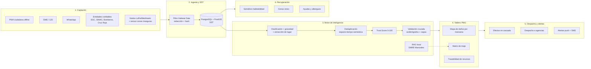

# CLAUDE.md — Dacora · Prototipo Hackathon UNAL Manizales 2026 (Vertical 5)

> Documento de arranque para un agente de Claude Code. Colócalo en la raíz del repositorio con el nombre `CLAUDE.md`.
> Consolida todo lo que hay en la carpeta de Drive **"Hackathon 2026"** (estudios, investigación, patentes, EMRE Manizales 2024) y el **diagrama técnico** que viene embebido en `estudio_integral_de_prefactibilidad_y_arquitectura_sidar.md`.
> Última actualización: 20 nov 2026, 22:00 (hora de Colombia).

---

## 0. Instrucciones para el agente (léelas primero)

1. **Idioma:** toda la interfaz, los mensajes al usuario, los textos de demo y la documentación van en **español de Colombia**. Los identificadores de código (variables, tablas, endpoints) van en inglés; el glosario de la sección 13 mapea los términos.
2. **El reloj manda.** El pitch de selección es el **sábado 21 nov a las 2:00 p. m.** y la Mentoría 2 a las **10:30 a. m.** Todo lo P0 (sección 8) debe poder demostrarse antes de las 10:00 a. m. del sábado. Prefiere algo simple que funcione a algo completo que no arranque.
3. **Antes de escribir código**, pregunta al usuario:
   - si ya existe código del equipo (el estudio SIRA dice que el triaje con puntaje 0–100 "ya está prototipado" y que logró "13 de 13 en escenario sintético"); si existe, intégralo en vez de reescribirlo;
   - quién del equipo (5 personas) toma frontend, backend/NLP, datos/GIS y pitch;
   - si hay Docker disponible en las máquinas de la demo.
4. **Arquitectura objetivo = el diagrama técnico (sección 3).** El prototipo implementa una **rebanada vertical funcional** de esa arquitectura; lo que no se alcance se **simula con datos sintéticos claramente etiquetados** ("SIMULADO") y se deja el punto de integración listo.
5. **Nunca uses datos personales reales.** Todo el escenario de demo es sintético (Ley 1581 de 2012). No descargues ni publiques nombres, cédulas o teléfonos reales.
6. **La IA solo sugiere; decide un humano.** Ningún reporte con señales de vida en riesgo (personas atrapadas, heridos, incendio, fuga de gas) puede descartarse automáticamente, aunque su puntaje de veracidad sea bajo: va a la cola de revisión humana.
7. **Sin dependencias de nube obligatorias.** Todo debe correr en un portátil sin internet (modo Plan B). Servicios externos (SGC, WhatsApp, SMS reales) quedan detrás de adaptadores con implementación simulada por defecto.
8. **Commits atómicos y continuos** (estándar obligatorio, ver sección 0.1). Mantén un `README.md` con "cómo correr la demo en 1 comando".

### 0.1 Estándar de commits

- **Un commit por unidad lógica:** cada componente, especificación, artefacto de Spec Kit (`spec.md`, `plan.md`, `tasks.md`), tarea implementada, corrección o cambio de configuración va en su propio commit. **Nunca** un commit masivo que mezcle componentes.
- **Commits concurrentes al trabajo:** se hace el commit en cuanto el componente o la especificación queda terminado y verificado, no al final de la sesión. Lo mismo para los cambios de documentación que lo acompañan.
- **Atomicidad:** un commit debe poder revertirse solo sin romper otro componente. Si un mensaje necesita "y" para describir dos cambios distintos, son dos commits. Separar backend (`services/api`), frontend (`apps/web`), datos/scripts y docs salvo que el cambio sea inseparable (p. ej. modelo Pydantic + tipos TS regenerados, que van juntos).
- **Formato:** [Conventional Commits](https://www.conventionalcommits.org/) en inglés: `<tipo>(<alcance>): <resumen en imperativo>`. Tipos: `feat`, `fix`, `docs`, `test`, `refactor`, `chore`, `build`, `ci`, `perf`. Alcances sugeridos: `api`, `web`, `engine`, `privacy`, `data`, `scripts`, `spec`, `constitution`, `speckit`, `infra`.
- **Cada commit pasa las pruebas y linters** de lo que toca; no se suben secretos, sales ni datos personales reales.
- **Push** al remoto después de cada grupo de commits terminado, para que el equipo trabaje sobre lo último.

---

## 1. Contexto del reto

| Ítem | Detalle |
|---|---|
| Evento | Hackathon UNAL Manizales 2026 — recuperación del Eje Cafetero post-sismo |
| Fechas | Vie 20 y sáb 21 nov 2026 (48 h presenciales), Campus La Nubia, Bloque X, salón X201 |
| Vertical | **05 · Datos & Inteligencia Operativa — "Datos, alerta y coordinación"** |
| Pregunta | ¿Cómo convertir información dispersa en decisiones confiables y oportunas? |
| Entregable oficial | **Tablero de comando situacional geoespacial con módulo de triaje y verificación de veracidad de reportes ciudadanos** |
| KPI oficial | Tiempo de consolidación del mapa de daño situacional y **tasa de detección de reportes falsos o duplicados > 90 %** |
| Restricciones | **Ley 1581 de 2012 (Habeas Data)** y **arquitectura offline-first** |
| Usuarios | Puesto de Mando Unificado (PMU), Alcaldía de Manizales (UGR), Gobernación de Caldas, ciudadanía |
| Equipo | 5 integrantes |
| Nombre del sistema | **Dacora** (nombre oficial del producto; los estudios previos lo llaman SIDAR — Sistema Integral de Datos, Alerta y Recuperación — o SIRA. En la interfaz, el código y la documentación nueva se usa siempre **Dacora**) |

### Rúbrica del jurado (100 pts) y qué debe mostrar el prototipo

| Componente | Pts | Qué aporta el software |
|---|---|---|
| 1. Problema y vertical | 20 | Escenario de demo basado en el sismo real del 10 ago 2026 (sección 2) |
| 2. **Prototipo** | **25** | Demo en vivo: captura offline → triaje → deduplicación → mapa PMU → despacho |
| 3. Conocimiento utilizado | 15 | Capas/feeds que representan capacidades UNAL (RAMAN, SISMAN-LISA, IDE-UNAL, patentes) |
| 4. Plan 30–90 días | 15 | Puntos de integración documentados (adaptadores) |
| 5. Viabilidad y aliados | 15 | Habeas Data desde el diseño, offline-first, software abierto |
| 6. Impactos | 10 | **Panel de KPI medido en vivo** (detección de duplicados/falsos, tiempo a mapa consolidado) |

---

## 2. El problema con evidencia (para el escenario de demo)

**Sismo del 10 de agosto de 2026:** M 7,4, 103 km de profundidad, epicentro San José del Palmar (Chocó), 7:34 a. m. Manizales declaró calamidad pública y activó PMU, Comité de Emergencias y Sala de Crisis (UGR lidera).

Hallazgos que el prototipo debe resolver de forma visible:

1. **Cifras que cambian y se contradicen.** Viviendas con "afectación total": 1.449 (13 ago) → 2.700 (14 ago) → 1.512 (15 ago). Gobernación reportó 142 viviendas afectadas en Manizales el mismo día en que la Alcaldía hablaba de ~2.000 solicitudes. → **Cada cifra del tablero muestra fuente, versión y fecha/hora de corte.**
2. **Sin diccionario de datos común.** "Afectación total", "pérdida total", "colapso total" se usan como sinónimos. → **Diccionario de indicadores** fijo en el sistema.
3. **Visitas repetidas al mismo inmueble** (hasta 3) y conteos de visitas en vez de predios. → **Identificador único de predio** (código catastral o, en su defecto, id de manzana + dirección normalizada) que trace solicitud → visita → clasificación → beneficio.
4. **Herramientas ad hoc** (Google Forms, SMS sueltos, puntos presenciales).
5. **Sin cobertura satelital:** Copernicus (EMSR916) no definió área de interés en Manizales pese a 361 reportes de daño (2.º municipio después de Cali). → la verificación se apoya en **sensores locales y corroboración entre fuentes**, no en satélite.
6. **Saturación del 123:** patrón nacional de 30–70 % de llamadas improcedentes o falsas. **Cortes de energía y red celular** en Manizales y Pereira frenaron la consolidación de reportes.
7. **Lección de 1999:** a los 4 días se estimaban 35.000 viviendas afectadas; el censo real fue 79.500. 731 desaparecidos registrados por confusión.

Indicadores que realmente usó el PMU para decidir (mostrarlos en el tablero): solicitudes de visita vs. visitas hechas vs. pendientes; clasificación de daño/habitabilidad (menor, mediano con uso restringido, mayor, colapso); predios evacuados y personas damnificadas; RUD (Registro Único de Damnificados); personas y mascotas en albergue; sedes educativas afectadas; comercios con afectación crítica/alta; usuarios sin gas/energía/agua; puntos de escombros.

---

## 3. Arquitectura objetivo (diagrama técnico)

Fuente: imagen embebida en `estudio_integral_de_prefactibilidad_y_arquitectura_sidar.md` (Drive, carpeta Hackathon 2026). Se reproduce aquí en texto y Mermaid. Si quieres ver la imagen original, está también en Drive como `arquitectura_sidar_diagrama_tecnico.png`; la copia del repositorio está en [docs/arquitectura.jpeg](docs/arquitectura.jpeg). El estado actual del prototipo (qué está implementado, simulado o planeado) está en [docs/arquitectura_actual.png](docs/arquitectura_actual.png), con fuente editable en [docs/arquitectura_actual.svg](docs/arquitectura_actual.svg).

**Título del diagrama:** "Diagrama técnico: Sistema Integral de Datos, Alerta y Recuperación Post-Sismo — Reto 05 · Datos & Inteligencia Operativa · PMU Eje Cafetero (Manizales – UNAL) — Solución End-to-End desde Crisis hasta Reconstrucción".

Flujo de izquierda a derecha, seis bloques:

**1. Captación de datos (inputs)**
- *Online:* WhatsApp y APIs públicas.
- *Entidades confiables:* SIMAC, SGC, Alcaldía, Bomberos, Cruz Roja, Defensa Civil.
- *Offline/SMS:* SMS de emergencia y reporte del canal 123 (red celular de señalización).
- *Hardware de campo:* nodos LoRaWAN / malla + sensores de zonas inseguras UNAL.

**2. Ingesta y SST (Single Source of Truth)**
- *Módulo Habeas Data:* anonimización en el borde (Ley 1581 de 2012, borrado de datos personales).
- *Consolidación en SST:* base de datos unificada offline-first (local en PMU / Supercómputo UNAL).

**3. Motor de inteligencia y verificación (Supercómputo UNAL)**
- *Modelos NLP & triaje:* clasificación automática, extracción de ubicación y gravedad.
- *Filtro fake news & deduplicación:* agrupamiento semántico de reportes, cálculo de **Trust Score**.
- *RAG local (LLM local):* inyección de protocolos de emergencia y manuales de Manizales.
- *Validación cruzada GIS (IDE-UNAL):* cruce físico con acelerógrafos y capas históricas de 1999.

**4. Tablero situacional (PMU)**
- *Mapa de daños geoespacial* (capas GIS en tiempo real).
- *Matriz de triaje & categorización* (Crítico, Alto, Medio, Bajo).
- *Dashboard de control y trazabilidad de recursos.*

**5. Despacho, alertas y predicción**
- *Predicción de efectos en cascada* (deslizamientos, colapsos por lluvia/sismo).
- *Despacho inteligente:* georreferenciación y enrutamiento automático a agencias locales.
- *Alertas multicanal:* notificaciones push al PMU + SMS cifrados a cuadrillas en campo.

**6. Recuperación inteligente post-sismo (diferencial)**
- *Evaluación de habitabilidad:* inspección y semáforo (verde/amarillo/rojo) + cruce catastro y SGC.
- *Censo único de damnificados:* registro familiar único, prioridades (vulnerabilidad), evita duplicidad.
- *Atención, albergues y vivienda temporal:* control de subsidios y ayudas humanitarias.
- *Infraestructura & servicios críticos:* agua, energía, gas, vías, hospitales y remoción de escombros.
- *Reconstrucción & financiación transparente:* reforzamiento NSR-10, créditos Findeter/Bancóldex, control de fondos.
- *Reactivación, apoyo social y transparencia:* empleo local, apoyo psicosocial, portal público "Reconstruir Mejor".

**Matriz de resiliencia y hardware (niveles de continuidad operativa)**

| Plan | Condición | Cómo opera |
|---|---|---|
| **A — Online total** | Nube, 4G/fibra | APIs, dashboards remotos |
| **B — Offline-first** | Sin internet | Servidor local (Supercómputo UNAL / PMU), edge computing, **SMS gateway sin internet** |
| **C — Colapso total** | Sin red celular | Redes malla LoRaWAN, radiofrecuencia de rescatistas, telemetría de campo UNAL |



---

## 4. Stack tecnológico

El estudio define el stack de producción. Para el prototipo usamos el mismo núcleo y **reemplazamos lo pesado por equivalentes livianos**, dejando el punto de integración listo.

### 4.1 Arquitectura de servicios (decisión del equipo, 20 nov 2026)

La aplicación tiene **solo dos servicios principales** que se comunican **vía API REST**:

| Servicio | Tecnología | Responsabilidad |
|---|---|---|
| `api` (backend) | **Python + FastAPI** | Único dueño de la lógica de negocio, del motor (Habeas Data, NLP, deduplicación, trust score), del acceso a la base de datos y de los adaptadores externos. Expone la API REST versionada en `/api/v1` y su contrato en `/openapi.json` |
| `web` (frontend) | **Next.js** | **Frontend puro**: PWA ciudadana, tablero PMU, campo y recuperación. **Sin** Route Handlers (`app/api/`), **sin** Server Actions con lógica de negocio y **sin** acceso directo a la base. Toda lectura/escritura pasa por la API REST de FastAPI |

Reglas:
- **Contrato:** FastAPI publica OpenAPI; el frontend genera sus tipos TS con `openapi-typescript` y usa un cliente `fetch` tipado (`apps/web/lib/api/`). Si cambia un modelo Pydantic, se regeneran los tipos en el mismo commit.
- **Tiempo real:** única excepción al REST puro: `GET /api/v1/stream` (Server-Sent Events, servido por FastAPI) para que el tablero reciba eventos nuevos. Si SSE falla, el tablero degrada a polling REST (`GET /api/v1/incidents?since=`).
- **Servicios de soporte (no principales):** `db` (PostgreSQL + PostGIS) y, opcionalmente, `ollama` (P2). Solo `api` habla con ellos; `web` nunca.
- **Redacción en el borde:** `lib/redact.ts` corre en el navegador antes de enviar; no es lógica de servidor de Next.js.
- Scripts (`replay_scenario.py`, `simulate_sms.py`, …) son clientes de la misma API REST; no escriben directo en la base.

| Capa | Producción (estudio) | **Prototipo (usar esto)** |
|---|---|---|
| Frontend | React/Next.js (TypeScript) PWA + MapLibre GL | **Next.js 14+ (App Router, TypeScript) como PWA, frontend puro** + **MapLibre GL JS** + Tailwind. Service worker con `next-pwa` o Workbox. Cliente REST tipado generado desde OpenAPI (`openapi-typescript`) |
| Almacenamiento en dispositivo | IndexedDB (PouchDB) | **IndexedDB con Dexie.js** y patrón *outbox* (cola de envíos con UUID generado en el cliente, reintento al volver la red). PouchDB/CouchDB es la alternativa si el equipo la prefiere |
| Backend | Python (FastAPI) | **FastAPI** (único backend, API REST `/api/v1` + OpenAPI) + Pydantic v2 + SQLAlchemy 2 / GeoAlchemy2 |
| Base de datos | PostgreSQL + PostGIS | **PostgreSQL 16 + PostGIS** (docker). Fallback sin Docker: SQLite + cálculos geográficos en Python (haversine) |
| Bus de eventos | Apache Kafka | **No usar Kafka en el prototipo.** Tareas en segundo plano de FastAPI + tabla `events` + Server-Sent Events (SSE) hacia el tablero. Dejar interfaz `EventBus` para cambiar a Kafka después |
| NLP | Transformer ajustado a dialecto colombiano en ONNX (CPU) | **`sentence-transformers` multilingüe** (`paraphrase-multilingual-MiniLM-L12-v2`) para embeddings + **clasificador por reglas/léxico en español colombiano** como base robusta. Si el modelo no se puede descargar, degradar a TF-IDF de scikit-learn sin romper nada |
| LLM / RAG | Llama 3 cuantizado | **Opcional (P2):** Ollama con `llama3.2:3b` o `llama3.1:8b` + índice de embeddings sobre la EMRE. Detrás de *feature flag*; si no hay Ollama, el tablero muestra el protocolo por reglas |
| Modelo de daño | OpenQuake Engine + ShakeMap SGC + catastro | **Simulado:** campo de PGA sintético por manzana (atenuación simple + factor de microzonificación). Interfaz `HazardProvider` para conectar ShakeMap/FDSN del SGC después |
| Mapas base | GeoServer + IDE-UNAL | Teselas vectoriales offline (PMTiles de Manizales) o, si no hay, fondo simple + GeoJSON propio. No depender de teselas en línea en la demo |
| Orquestación | Kubernetes (k3s) | **`docker compose up`** con los servicios principales `api` y `web`, el servicio de soporte `db` (+ `ollama` opcional) |

Requisitos de calidad: tipado estricto (TS `strict`, mypy en lo crítico), `ruff` + `black` en Python, `eslint` + `prettier` en TS, tests con `pytest` y `vitest`.

---

## 5. Estructura sugerida del repositorio

```
dacora/
├── CLAUDE.md
├── README.md                     # cómo correr la demo en 1 comando
├── docker-compose.yml            # api, web (principales) + db (postgis), [ollama]
├── .env.example
├── docs/
│   ├── arquitectura.jpeg         # diagrama técnico
│   ├── diccionario_indicadores.md
│   └── guion_demo.md
├── apps/web/                     # Next.js PWA (frontend puro, sin app/api/)
│   ├── lib/api/                  # tipos generados desde /openapi.json + cliente fetch tipado
│   ├── app/reportar/             # PWA ciudadana (offline)
│   ├── app/pmu/                  # tablero situacional
│   ├── app/campo/                # formulario de inspección (semáforo) para ingenieros
│   ├── app/recuperacion/         # censo único, ayudas, albergues
│   ├── lib/db.ts                 # Dexie + outbox
│   ├── lib/redact.ts             # redacción de PII en el borde (espejo de privacy.py)
│   └── public/manifest.json
├── services/api/
│   ├── app/main.py
│   ├── app/routers/              # ingest, reports, incidents, sensors, dispatch, alerts, recovery, metrics
│   ├── app/core/privacy.py       # redacción, hash con sal
│   ├── app/core/nlp.py           # categoría, gravedad, ubicación
│   ├── app/core/dedup.py         # agrupamiento
│   ├── app/core/trust.py         # trust score
│   ├── app/core/geo.py           # geocodificación por gazetteer local, manzanas
│   ├── app/adapters/             # sms, whatsapp, sgc, lora, rfid (todos con implementación SIMULADA)
│   └── tests/
├── data/
│   ├── geo/                      # manzanas, barrios, comunas (GeoJSON), gazetteer
│   ├── seed/                     # escenario sintético 10-ago-2026 con etiquetas de verdad
│   └── rag/                      # textos de la EMRE para el RAG
└── scripts/
    ├── generate_scenario.py      # crea reportes sintéticos con duplicados y falsos etiquetados
    ├── replay_scenario.py        # "reproduce" el sismo minuto a minuto contra la API
    ├── simulate_sms.py           # envía SMS en formato compacto
    ├── simulate_sensors.py       # lecturas sintéticas tipo RAMAN y sensor de zona insegura
    └── evaluate_kpis.py          # precisión/recall de duplicados y falsos, tiempo a mapa
```

---

## 6. Modelo de datos (SST)

Todas las tablas llevan `id UUID`, `created_at`, `source`, `version` y, donde aplique, `cutoff_at` (fecha de corte). Los reportes son **solo-agregar** (nunca se sobrescriben); los cambios de estado se guardan en `report_events` con quién y cuándo.

| Tabla | Campos clave |
|---|---|
| `reports` | `client_uuid` (idempotencia), `channel` (pwa, sms, whatsapp, call_123, entity, lora), `received_at`, `occurred_at`, `text_redacted`, `location_text`, `geom POINT(4326)`, `geo_precision` (gps, address, barrio, none), `manzana_id`, `category`, `severity`, `triage_level` (critico, alto, medio, bajo), `people_affected`, `has_media`, `reporter_hash` (hash con sal, nunca el dato claro), `cluster_id`, `trust_score`, `trust_breakdown JSONB`, `status` (nuevo, en_revision, verificado, descartado, duplicado, atendido), `is_life_threat` |
| `report_events` | `report_id`, `actor_role`, `action`, `payload`, `at` (bitácora auditable) |
| `incidents` (clusters) | `centroid`, `category`, `triage_level`, `report_count`, `independent_sources`, `trust_score`, `first_seen`, `last_seen`, `status`, `assigned_agency` |
| `manzanas` | `id` (código DANE o sintético), `geom POLYGON`, `barrio`, `comuna`, `seismic_zone`, `buildings_pre_1984_pct`, `population` |
| `sensors` / `sensor_readings` | estaciones tipo RAMAN (`station_code`, `geom`), lecturas `pga_g`, `at`; sensor de zona insegura (`intrusion`, `rfid_authorized`) |
| `hazard_estimates` | por manzana: `pga_g`, `p_damage_moderate`, `p_collapse`, `model_version` |
| `resources` / `dispatches` / `resource_tracks` | cuadrillas y vehículos (`agency`, `type`, `status`), despachos a incidentes, puntos de paso tipo RFID |
| `alerts` | `type`, `area GEOMETRY`, `message`, `channel` (push, sms), `approved_by_role` (**solo COE aprueba**), `sent_at` |
| `building_inspections` | `property_id` (catastral o manzana+dirección normalizada), `color` (verde, amarillo, rojo), `damage_level` (menor, mediano_uso_restringido, mayor, colapso), `inspector_role`, `photos`, `at` |
| `households` (censo único) | `household_hash`, `members_count`, `vulnerability_flags` (niñez, adulto mayor, discapacidad — en tabla separada con acceso restringido), `property_id`, `rud_status` |
| `aid_deliveries` | `household_hash`, `aid_type` (subsidio_arriendo, kit, mercado, albergue), `at`, `source_fund` |
| `metrics_snapshots` | indicador, valor, fuente, `cutoff_at`, versión (para el panel con fecha de corte) |

---

## 7. Lógica central (motor de inteligencia)

### 7.1 Filtro Habeas Data (en el borde y en la API)
- Detectar y **redactar antes de persistir**: cédulas (6–10 dígitos), celulares colombianos (`3\d{9}`, con o sin +57), correos, placas, nombres propios precedidos de "me llamo", "soy", "mi mamá …" (reglas + NER de spaCy `es_core_news_sm` si está disponible).
- Reemplazar por marcadores (`[TEL]`, `[CC]`, `[NOMBRE]`). Guardar solo `HMAC-SHA256(sal, dato_normalizado)` para poder cruzar duplicados y censo sin conocer el dato.
- Implementar la misma función en TypeScript (`lib/redact.ts`) para que la PWA redacte **antes de enviar** ("anonimización en el borde"); la API vuelve a aplicar la redacción (es la autoridad).
- Aviso de privacidad y consentimiento explícito en la PWA antes del primer reporte.
- Datos sensibles (salud, niñez, discapacidad) en tablas separadas y visibles solo para roles autorizados.
- Todo lo público se publica **agregado por manzana o barrio con k ≥ 5**; nunca nombres, cédulas ni direcciones exactas.

### 7.2 Clasificación y gravedad
Categorías (adaptadas de HumAID al contexto sísmico de Manizales):
`personas_atrapadas`, `heridos`, `colapso_estructura`, `dano_estructural`, `incendio`, `fuga_gas`, `deslizamiento`, `via_bloqueada`, `servicios_caidos` (agua, energía, gas, telecom), `necesidad_albergue`, `necesidad_ayuda` (agua, comida, medicamentos), `persona_desaparecida`, `sismo_sentido`, `rumor_informacion`.

Matriz de triaje:

| Nivel | Criterio |
|---|---|
| **Crítico** | personas atrapadas, heridos graves, colapso con personas, incendio, fuga de gas, deslizamiento sobre viviendas ocupadas |
| **Alto** | daño estructural severo, vía bloqueada hacia hospital/albergue, deslizamiento activo, hospital o colegio afectado |
| **Medio** | daño moderado, servicios caídos por sector, necesidad de albergue |
| **Bajo** | daño leve, sismo sentido, información general |

`is_life_threat = true` para las categorías de Crítico; esos reportes nunca se descartan sin revisión humana.

Extracción de lugar: gazetteer local (`data/geo/gazetteer.csv`) con barrios, comunas, vías y referencias de Manizales (Centro, Milán, Chipre, La Enea, Palermo, Palogrande, San José, Villa Pilar, El Cable, La Francia, Av. Santander, Av. Paralela, carrera 23, Catedral, Coliseo Mayor, Hospital Santa Sofía, Cable Aéreo, etc.). Coordenada de referencia del centro: `5.0689, -75.5174`. Si no hay GPS, ubicar en el centroide del barrio con `geo_precision = barrio`.

### 7.3 Deduplicación
- Un reporte nuevo se une a un `incident` existente si: misma categoría o compatible, **distancia ≤ 250 m** (≤ 600 m si `geo_precision = barrio`), **ventana ≤ 3 h**, y **similitud coseno ≥ 0,75** entre embeddings (o ≥ 0,6 si la ubicación es exacta).
- Duplicado ≠ basura: el reporte duplicado **suma corroboración** y completa datos faltantes (idea de la patente US 10,742,809: aprovechar el duplicado para completar información).
- Mismo `reporter_hash` repitiendo el mismo mensaje → no cuenta como fuente independiente.
- Parámetros en `config` para calibrarlos con `evaluate_kpis.py`.

### 7.4 Trust Score (0–100)
Suma ponderada, guardando el desglose en `trust_breakdown` para mostrarlo en el tablero (explicabilidad):

| Señal | Peso orientativo |
|---|---|
| Confiabilidad del canal (entidad oficial 0,9 · inspector/organismo de socorro 0,85 · PWA con GPS y foto 0,6 · SMS 0,5 · WhatsApp reenviado 0,3) | 30 |
| Fuentes independientes en el mismo incidente (saturación en 4) | 25 |
| Consistencia física: PGA/daño estimado en la manzana vs. lo reportado | 20 |
| Precisión geográfica (GPS > dirección > barrio > nada) | 10 |
| Señales lingüísticas de desinformación (penaliza): "reenvía", "cadena", "dicen que", "me contaron", "urgente compartir", cifras exageradas sin lugar, menciones de predicción de sismos, alarmas de "réplica de 9" | −15 a 0 |
| Evidencia (foto, audio) | 5 |
| Confirmación por sensor de campo (zona insegura, nodo LoRa) | 10 |

Etiquetas: **Verificado ≥ 75**, **Probable 50–74**, **Sin verificar 25–49**, **Posible falso < 25**. Un humano del PMU puede confirmar o descartar; la acción queda en la bitácora.

### 7.5 Validación cruzada GIS
- `hazard_estimates` por manzana a partir de lecturas de acelerógrafos (simuladas tipo RAMAN, ~10 estaciones urbanas) interpoladas (IDW) y amplificadas por zona sísmica.
- Capa histórica "1999" sintética como contexto (etiquetada SIMULADA si no hay datos reales).
- Un reporte de colapso en una manzana con PGA muy bajo baja su consistencia física; uno en zona de alto PGA la sube.

### 7.6 Nivel de emergencia sugerido (EMRE Manizales 2024)
El tablero sugiere el nivel (la decisión es del CMGRD/COE):

| Nivel | Criterio resumido |
|---|---|
| 0 | Evento puntual, atendible por las instituciones sin afectar la normalidad |
| 1 | 1–2 sitios de afectación; ≥ 5 heridos o fallecidos; 5–10 familias afectadas; una institución desbordada |
| 2 | Afectación extendida en un barrio/vereda o 3 sitios; 10–20 familias; amerita calamidad pública; sala de crisis 24 h |
| 3 | ≥ 3 barrios/veredas o > 4 sitios; > 50 heridos/fallecidos o cifra indeterminada; apoyo departamental y nacional |

Cadencia de reportes de situación que exige la EMRE (generar exportable): **cada 6 h** las primeras 72 h, **cada 12 h** días 3–5, **cada 24 h** desde el día 5. Contenido de la sala de crisis: organigrama, bitácora, directorio, inventario de recursos, datos de afectación (censo), mapa de la zona afectada, listado de necesidades.

### 7.7 Despacho (enrutamiento a agencias según las 6 funciones de respuesta de la EMRE)

| Función EMRE | Categorías | Agencia sugerida |
|---|---|---|
| 1. Salvamento y seguridad | personas_atrapadas, incendio, fuga_gas, colapso | Cuerpo Oficial de Bomberos, Defensa Civil, Policía |
| 2. Salud y saneamiento | heridos | Cruz Roja, Secretaría de Salud |
| 3. Asistencia social | necesidad_albergue, necesidad_ayuda, persona_desaparecida | Secretaría de Desarrollo Social, Cruz Roja |
| 4. Infraestructura, servicios y ambiente | dano_estructural, via_bloqueada, servicios_caidos, deslizamiento | Secretaría de Infraestructura, Aguas de Manizales, CHEC, Efigas, Corpocaldas |
| 5. Manejo y coordinación | alertas, información pública | UGR / COE |
| 6. Logística | recursos, telecomunicaciones, donaciones | UGR / Logística |

**Alertas:** según la EMRE (tarea 5.5), **solo el COE emite alertas oficiales**. En el sistema, una alerta queda en borrador hasta que un usuario con rol `coe` la aprueba.

---

## 8. Alcance del prototipo por prioridad

### P0 — Imprescindible para el pitch (antes del sábado 10:00 a. m.)
1. `docker compose up` levanta todo y carga el escenario sintético.
2. **PWA ciudadana offline:** formulario corto (categoría, descripción, ubicación GPS o barrio, personas, foto opcional), aviso de privacidad, redacción de PII en el borde, guardado en IndexedDB y **sincronización automática al volver la red** (demostrable con modo avión).
3. **Canal SMS simulado:** `POST /ingest/sms` con formato compacto ≤ 160 caracteres: `DACORA <CAT> <BARRIO o lat,lon> <N_PERSONAS> <texto>` (ej. `DACORA ATR MILAN 3 edificio caido cra 23`). Códigos: ATR (atrapados), HER, COL, DAN, INC, GAS, DES, VIA, SER, ALB, AYU, DSP.
4. **Motor:** redacción → clasificación → gravedad → deduplicación → trust score, en < 1 s por reporte.
5. **Tablero PMU:** mapa MapLibre con incidentes (color por nivel de triaje, tamaño por número de reportes), capa de calor por manzana, lista/matriz de triaje filtrable, panel de detalle con el desglose del trust score y botones "Confirmar / Descartar / Marcar duplicado".
6. **Panel de KPI en vivo:** % de duplicados y falsos detectados (contra la verdad del escenario), reportes recibidos vs. incidentes consolidados, **tiempo hasta mapa consolidado**, y cada cifra con fuente y fecha de corte.
7. `scripts/replay_scenario.py`: reproduce ~150–300 reportes del sismo del 10 ago en tiempo acelerado (ej. 1 h real = 1 min) para que el mapa "se llene" en vivo.

### P1 — Suma puntos (sábado antes de la Mentoría 2 si da el tiempo)
8. **Validación con sensores simulados** (acelerógrafos tipo RAMAN + PGA por manzana) y su efecto en el trust score.
9. **Despacho:** asignar incidente a agencia; recursos con trazas tipo RFID (puntos de paso) para evitar despachar dos veces al mismo incidente.
10. **Alertas:** borrador → aprobación COE → envío simulado (push en el tablero + log de SMS).
11. **Recuperación (módulo 6, vista mínima):** formulario de inspección con semáforo por predio, **censo único** con deduplicación por hash de hogar y bandera de ayuda duplicada.
12. Nivel de emergencia sugerido (EMRE) y exportación del reporte de situación.

### P2 — Solo si sobra tiempo o como "siguiente paso" del pitch
13. RAG local (Ollama) sobre la EMRE: al abrir un incidente, sugerir el protocolo y la tarea EMRE correspondiente.
14. Capa de efectos en cascada (deslizamiento por lluvia sobre manzanas de ladera con PGA alto).
15. Ingesta LoRa/Meshtastic (mensajes compactos tipo SMS desde un nodo) y eventos del sensor de zonas inseguras.
16. Portal público "Reconstruir Mejor" con índice de recuperación por barrio (agregado, k ≥ 5).

---

## 9. API mínima

API REST de FastAPI. Todas las rutas van bajo el prefijo **`/api/v1`** (ej. `POST /api/v1/ingest/report`); el contrato se publica en `/openapi.json` y de ahí se generan los tipos del frontend. `GET /stream` (SSE) es la única ruta no REST.

| Método | Ruta | Uso |
|---|---|---|
| POST | `/ingest/report` | PWA y entidades. Idempotente por `client_uuid` |
| POST | `/ingest/sms` | SMS compacto (y mensajes LoRa con el mismo formato) |
| POST | `/ingest/batch` | Sincronización del outbox de la PWA |
| GET | `/reports?status=&triage=&since=` | Lista filtrable |
| PATCH | `/reports/{id}` | Confirmar, descartar, marcar duplicado (queda en bitácora) |
| GET | `/incidents` · `/incidents/{id}` | Clusters con trust score y desglose |
| GET | `/map/manzanas` | GeoJSON agregado por manzana (conteos, PGA, nivel) |
| GET | `/stream` | SSE con eventos nuevos para el tablero (excepción al REST; fallback: polling a `/incidents?since=`) |
| POST | `/sensors/readings` | Lecturas simuladas |
| POST | `/dispatches` · GET `/resources` | Despacho y trazabilidad |
| POST | `/alerts` · POST `/alerts/{id}/approve` | Alertas (aprobación solo rol `coe`) |
| POST | `/recovery/inspections` · `/recovery/households` · `/recovery/aid` | Módulo 6 |
| GET | `/metrics/kpi` · `/metrics/sitrep` | KPI con fecha de corte y reporte de situación |

Roles simples para la demo (sin Keycloak; token fijo por rol en `.env`): `ciudadano`, `operador_pmu`, `coe`, `inspector`, `agencia`, `publico`.

---

## 10. Escenario de demo (datos sintéticos)

- Evento: sismo 10 ago 2026, 07:34, M 7,4. Ventana de 0 a 12 h.
- Distribución de reportes concentrada en Centro, Milán, Av. Santander, Av. Paralela, carrera 23 (sectores con revisión edificio por edificio en el evento real), con menor densidad en otros barrios.
- Mezcla objetivo: ~55 % reportes únicos legítimos, ~30 % duplicados (mismo hecho por varios canales y personas), ~15 % falsos o rumores (cadenas de WhatsApp, "réplica de 9 a las 3 p. m.", "se cayó el puente X" inexistente).
- Cada reporte sintético lleva `ground_truth` (`unique`, `duplicate_of`, `fake`) en un archivo aparte que **no** ve el motor; `evaluate_kpis.py` lo usa para calcular precisión y recall. Meta: **> 90 %** de detección de duplicados y falsos con **< 2 % de falsos negativos en reportes críticos**.
- Geografía: intentar descargar manzanas/barrios del geoportal municipal (`https://geodata-manizales-sigalcmzl.opendata.arcgis.com`) o del Marco Geoestadístico del DANE. **Si no hay red**, generar una grilla sintética de manzanas sobre el casco urbano y un gazetteer con centroides aproximados de barrios, etiquetado "SIMULADO".

### Guion de la demo (3–4 min)
1. Contexto en 20 s: cifras que cambiaron 1.449 → 2.700 → 1.512; Manizales sin satélite.
2. Se lanza `replay_scenario.py`: el tablero empieza a recibir reportes.
3. Celular en **modo avión** → reporte desde la PWA → queda en cola → se activa la red → aparece en el mapa.
4. Se envía un SMS simulado de personas atrapadas → entra como **Crítico** y se une a un incidente existente (duplicado detectado, suma corroboración).
5. Una cadena de WhatsApp falsa aparece como **Posible falso** con el desglose de por qué.
6. Se despacha Bomberos al incidente; se ve la traza del recurso.
7. Panel de KPI: X reportes → Y incidentes, Z % de duplicados/falsos detectados, mapa consolidado en N minutos simulados, todo con fecha de corte.
8. Cierre con el módulo de recuperación: semáforo de un predio y censo sin duplicados.

---

## 11. Capacidades UNAL y patentes que el prototipo debe representar (componente 3)

Representarlas como **capas o feeds con su nombre** en el tablero (aunque sean simulados) para que el jurado las vea:

| Capacidad | Cómo aparece en el prototipo |
|---|---|
| **RAMAN** — Red de Acelerógrafos de Manizales (10 superficie + 1 en pozo; Corpocaldas/UGR/UNAL) y Red Acelerográfica del Observatorio (40+ estaciones, CC BY-NC 4.0) | Capa de estaciones y PGA por manzana (simulado) |
| **SISMAN-LISA** (IDEA–UNAL): daño probable edificio por edificio cruzando con base predial | "Prior" de daño por manzana en la validación cruzada |
| **SAT de Manizales** (UGR + UNAL) | Capa de amenazas secundarias (deslizamiento/inundación), P2 |
| **SIMAC / CDIAC** (geoportal) | Fuente "entidad confiable" y capas de contexto |
| **IDE-UNAL** | Origen declarado de las capas GIS; exportar en estándares OGC (GeoJSON/WFS) |
| **Centro de Datos y Supercómputo UNAL** | Nodo del Plan B (servidor local) |
| **ERIS-UNAL** (grupo innovaTE: API REST de rutas con probabilidad de bloqueo) | Adaptador `RoutingProvider` para despacho (simulado) |
| **Metodología holística de vulnerabilidad** (IDEA, Prof. O. D. Cardona) | Pesos de vulnerabilidad por manzana en la priorización |
| **Kit LoRaWAN** (Lab. Telecomunicaciones, La Nubia; préstamo a V3) | Plan C: ingesta de mensajes compactos desde nodos |
| Patente **NC2025/0015763** — Dispositivo de monitoreo de zonas inseguras (ultrasonido/IR + RFID de personal autorizado) | Feed de eventos de intrusión en edificios acordonados; confirma o alerta |
| Patente **15111163** — Plataforma RFID de control de vehículos (concedida, en portafolio) | Trazabilidad de recursos despachados |
| Patente **NC2022/0005821** — Alarma de lluvia por entropía de ecos | Capa de lluvia para efectos en cascada (P2) |
| Patente **NC2017/0013302** — Telecontrol seguro con IP privadas | Concepto de conexión segura de nodos de campo al PMU (documentar, no implementar) |
| Patentes NC2022/0005468 (ionosfera) y NC2022/0005810 (pararrayos IoT) | **No** presentarlas como alerta sísmica; solo como referencia de arquitectura IoT/telemetría |

Antecedentes a citar en la UI "Acerca de": HumAID / CrisisMMD (categorías), USGS "Did You Feel It?" (agregación por celda para reducir ruido), Ushahidi Haití 2010 (verificación manual = la brecha), #Verificado19S México 2017, local-first (Kleppmann), Meshtastic. Patente más cercana a diferenciar: **US 12,536,153** (validación autónoma de información crowdsourced): Dacora se diferencia por offline-first, agregación por manzana, sensores locales, español y Habeas Data desde el diseño.

---

## 12. Marco legal e institucional (lo que el código debe respetar)

- **Ley 1523 de 2012:** SNGRD; arts. 45–46 piden un sistema de información bajo estándares de la Infraestructura Colombiana de Datos Espaciales → exportar GeoJSON/OGC.
- **Ley 1581 de 2012** (+ Decreto 1377 de 2013): consentimiento, finalidad, seguridad, datos sensibles separados → sección 7.1.
- **Ley 1712 de 2014** (transparencia): portal público solo con agregados.
- **NSR-10:** referencia de la clasificación de daño y el semáforo.
- **RUD (UNGRD):** el censo único debe poder exportarse al formato del RUD (dejar exportador CSV con columnas configurables).
- **EMRE Manizales 2024:** el COE es la única autoridad para alertas oficiales; las 6 funciones de respuesta orientan el despacho; la sala de crisis exige reportes con cadencia definida.
- Modelo institucional propuesto: dueño = gobernaciones (convenio regional); operador técnico = UNAL Manizales; software abierto.

---

## 13. Glosario (UI en español ↔ código)

| UI | Código |
|---|---|
| Reporte ciudadano | `report` |
| Incidente / agrupación | `incident` |
| Puntaje de veracidad | `trust_score` |
| Nivel de triaje (Crítico/Alto/Medio/Bajo) | `triage_level` |
| Manzana | `manzana` |
| Predio | `property` |
| Evaluación de habitabilidad / semáforo | `building_inspection` / `color` |
| Censo único de damnificados | `households` |
| Ayuda entregada | `aid_delivery` |
| Despacho | `dispatch` |
| Fecha de corte | `cutoff_at` |
| PMU / COE / UGR | Puesto de Mando Unificado / Comité Operativo de Emergencias / Unidad de Gestión del Riesgo |
| EDAN | Evaluación de Daños y Análisis de Necesidades |
| PGA | Aceleración pico del suelo |

---

## 14. Criterios de "terminado" para P0

- [ ] `docker compose up` desde cero en < 5 min y la demo carga sola el escenario.
- [ ] La PWA funciona en modo avión y sincroniza sin duplicar (idempotencia por `client_uuid`).
- [ ] Ningún teléfono, cédula o correo aparece en la base de datos (test automático sobre el escenario).
- [ ] `evaluate_kpis.py` reporta > 90 % de detección de duplicados y falsos, y 0 reportes críticos descartados automáticamente.
- [ ] El tablero actualiza en vivo (SSE) y cada cifra muestra fuente y fecha de corte.
- [ ] `docs/guion_demo.md` permite que cualquier integrante haga la demo.
- [ ] Hay un video corto o GIF de respaldo por si falla algo en el pitch.

---

## 15. Fuentes (carpeta "Hackathon 2026" en Google Drive)

| Documento | Para qué sirve |
|---|---|
| `estudio_integral_de_prefactibilidad_y_arquitectura_sidar.md` | Estudio SIDAR (nombre anterior de Dacora) + **diagrama técnico** (arquitectura objetivo) |
| `Estudio de prefactibilidad SIRA, recuperación post-terremoto del Eje Cafetero.md` | Versión extendida: stack detallado, offline en 3 niveles, integraciones (SGC FDSN/QuakeML, IGAC LADM-COL, DANE, UNGRD, SECOP), modelo de daño, seguridad, riesgos, KPI |
| `Vertical 5 · Datos, alerta y coordinación — Hackathon UNAL Manizales 2026` | Ficha oficial del reto, rúbrica, agenda, capacidades UNAL, las 10 partes de la recuperación |
| `Sismo 10 ago 2026 Manizales – Reportes oficiales, contingencia e indicadores` | Evidencia del problema, cifras por corte, indicadores de decisión |
| `Antecedentes y estado del arte — Vertical 5` | NLP de crisis, verificación, plataformas, offline-first, patentes internacionales |
| `Patentes UNAL del Reto 5 — Ficha SIPI` y `Patentes UNAL adicionales para la Vertical 5` | Patentes y cómo encajan |
| Carpeta `EMRE/` (EMRE Manizales 2024: documento principal, responsabilidades institucionales, anexos 1–6, suplementos) | Niveles de emergencia y alerta, PMU/COE, sala de crisis, 6 funciones de respuesta y sus tareas, protocolo ante sismos. **Corpus para el RAG** |

Tareas de los anexos EMRE (útiles para el RAG y el despacho):
- **I. Salvamento y seguridad:** 1.1 aislamiento y seguridad, 1.2 búsqueda y rescate, 1.3 extinción de incendios, 1.4 riesgos tecnológicos y sustancias peligrosas, 1.5 evacuación.
- **II. Salud y saneamiento:** 2.1 prehospitalaria, 2.2 hospitalaria, 2.3 salud mental, 2.4 saneamiento, 2.5 vigilancia epidemiológica, 2.6 manejo de cadáveres.
- **III. Asistencia social** (coord. Secretaría de Desarrollo Social): 3.1 registro de población afectada y evaluación de necesidades, 3.2 alojamiento temporal, 3.3 ayuda humanitaria, 3.4 trabajo e información comunitaria.
- **IV. Infraestructura, servicios y ambiente** (coord. Secretaría de Infraestructura): 4.1 monitoreo de eventos, 4.2 evaluación de daños en edificaciones, 4.3 escombros (RCD), 4.4 líneas vitales, 4.5 impactos ambientales.
- **V. Manejo y coordinación:** 5.1 coordinación interinstitucional, 5.2 información pública, 5.3 asuntos jurídicos, 5.4 asuntos financieros, 5.5 manejo de alertas.
- **VI. Logística:** 6.1 equipos e inmuebles, 6.2 telecomunicaciones, 6.3 transporte, 6.4 **sistemas de información** (SIG, cuadros de situación, informes periódicos, registro histórico del COE), 6.5 suministros y donaciones (SUMA), 6.6 voluntarios.

Contexto de Manizales (EMRE): 12 comunas y 7 corregimientos; población proyectada 2024 de 457.022 habitantes (24.313 rurales); ciudad sobre una meseta estrecha con laderas de más de 60°; amenazas principales: movimientos en masa (las más recurrentes), sismos, incendios estructurales (bahareque), inundaciones, ceniza volcánica. Microzonificación sísmica disponible desde 2002 (actualizada en 2014 para NSR-10).
